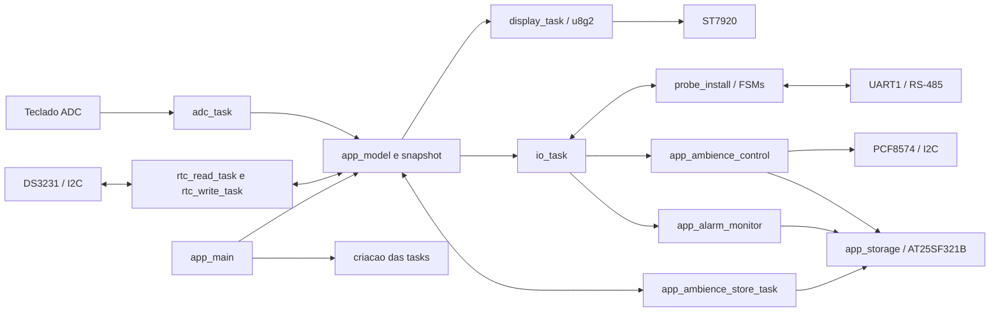
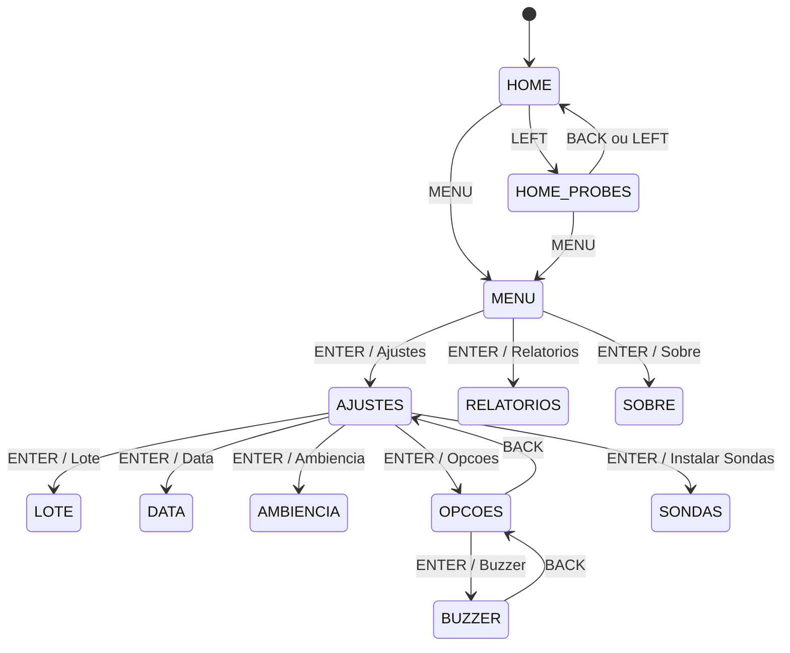
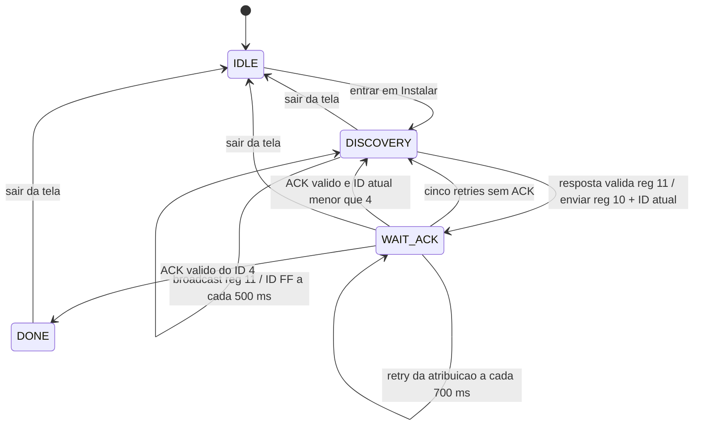

# Guia Tecnico do Sistema Smart Horta

Este documento descreve a implementacao atualmente presente no firmware. Ele foi
organizado como material de referencia para estudo e redacao do TCC: distingue o
que ja esta implementado do que e apenas ponto de extensao, explicita os fluxos
de dados e registra as limitacoes que nao devem ser apresentadas como recursos
concluidos.

O codigo-fonte e a fonte final de verdade. O guia especifico de sondas em
`GUIA_TECNICO_SONDAS.md` contem diagramas e detalhes adicionais desse subsistema;
este arquivo consolida sondas com UI, FreeRTOS, controle, lotes e persistencia.

## 1. Resumo do Sistema

O firmware executa em um ESP32 e combina:

- Interface local em LCD ST7920 128x64, renderizada pela biblioteca u8g2.
- Teclado resistivo lido pelo ADC1.
- RTC DS3231 conectado por I2C.
- Quatro sondas logicas, consultadas por UART1 em um barramento RS-485 half-duplex.
- Expansor PCF8574 para saidas de aspersores, irrigadores e exaustores.
- Memoria flash serial AT25SF321B para lote, curvas de Ambiencia e historico de alarmes.
- Tasks FreeRTOS separadas por funcao; `app_model` coordena o estado compartilhado.

O controle ambiental implementado e discreto por limites, atraso e histerese. Ele
nao e PID, nao identifica uma planta e nao estima um modelo dinamico do ambiente.
As metas das curvas sao interpoladas linearmente pela idade do lote; as saidas
sao acionadas em etapas segundo a magnitude da violacao.

## 2. Arquitetura em Camadas



### Responsabilidades

1. **Drivers e configuracao de hardware:** `app_pin_config`, `app_pcf8574`,
   `rtc_task`, `at25sf321b` e o callback GPIO/delay do display.
2. **Modelo e interface:** `app_model` e a autoridade de estado da navegacao,
   configuracao, telemetria publicada, relogio e lote; `display_task` apenas
   consome um snapshot para desenhar.
3. **Orquestracao:** `io_task` coordena LEDs, buzzer, sondas, controle ambiental,
   alarmes fixos e persistencia do lote.
4. **Persistencia:** `app_storage` serializa as operacoes fisicas; stores de lote,
   curvas e alarmes definem seus formatos logicos.

## 3. Hardware e Interfaces

| Subsistema | Interface e parametros | Pinos/endereco |
|---|---|---|
| MCU | ESP32, projeto ESP-IDF | configuracao da placa |
| Teclado | ADC1, 12 bits, atenuacao DB11 | GPIO36 / ADC1_CHANNEL_0 |
| RS-485 | UART1, 9600 baud, 8N1, half-duplex | TX17, RX16, RE/DE4 |
| Display | ST7920 128x64, SPI por software | CS5, DATA23, CLK18, RST32 |
| I2C | I2C_NUM_0, 100 kHz | SDA21, SCL22 |
| RTC | DS3231, endereco 0x68 | barramento I2C compartilhado |
| Expansor | PCF8574, endereco padrao 0x20, active-HIGH | barramento I2C compartilhado |
| Flash | AT25SF321B, SPI2, modo 0, 10 MHz | MISO19, MOSI25, CLK26, CS27 |
| Buzzer | saida digital | GPIO13 |
| LEDs | saidas digitais | GPIO15 e GPIO2 |

O mapa oficial e mantido em `MAPEAMENTO_PINOS.md` e os defines estao em
`components/app_io/app_pin_config.h`. P0..P1 do PCF8574 sao aspersores, P2..P3
sao irrigadores, P4..P5 sao exaustores, P6 e auxiliar e P7 nao e usado. O driver
inicializa as saidas de carga inativas em LOW (active-HIGH) e mantem P7 em HIGH.
O PCF8574 nao deve alimentar cargas diretamente; deve haver estagio de rele ou
transistor adequado.

## 4. Modelo de Dados e Sincronizacao

`app_model.h` define o contrato publico. A estrutura privada `app_model_data_t`
em `app_model.c` e protegida por mutex FreeRTOS. Escritores usam setters sob
mutex; consumidores usam `app_model_get_snapshot()` para receber uma copia
coerente sem reter o mutex durante desenho ou calculo.

O snapshot agrega:

- Tela raiz e cursores dos menus.
- Submodos de lote, data/hora, Ambiencia, Opcoes/Buzzer e sondas.
- Cinco curvas de Ambiencia e o estado de configuracao ON/OFF.
- Estado das quatro sondas, identidade/tipo e quatro leituras.
- Data/hora atual, inicio do lote, status e idade em dias.
- Estado dinamico do alarme e quantidade/posicao do relatorio persistido.

As quatro medidas por sonda sao `air_temperature`, `air_humidity`,
`soil_temperature` e `soil_humidity`. `installed` representa presenca/resposta
valida recente; `has_reading` indica que os dados numericos foram decodificados.
Slots de modelo 0..3 correspondem a IDs logicos 1..4.

O mutex protege os campos do modelo, nao os perifericos. O PCF8574 tem mutex
proprio para serializar alteracoes de bits. A flash tem uma fila/task propria.
Flags protegidas pelo modelo funcionam como pedidos de trabalho para lote, RTC,
beep e persistencia de curvas; nao ha fila geral de eventos da aplicacao.

## 5. Inicializacao e FreeRTOS

`main/app_main` executa, em resumo:

1. Inicializa `app_model`, incluindo mutex, menus, placeholders e curvas default.
2. Configura GPIOs/ADC e instala I2C para RTC e PCF8574.
3. Inicializa o PCF8574; falhas de I2C sao registradas.
4. Inicializa flash e `storage_task`; quando disponivel, restaura lote, curvas e
   historico de alarmes antes de criar as tasks de aplicacao.
5. Cria tasks de teclado, I/O, display, RTC e persistencia de curvas.

Antes da primeira leitura valida do DS3231, o modelo inicia a data/hora em
01/01/2026 00:00:00. Falha de leitura gera log e nova tentativa apos 1 s; o
modelo continua com o ultimo valor conhecido, inclusive o default se nenhuma
leitura anterior teve sucesso.

| Task | Prioridade configurada | Stack passada a `xTaskCreate` | Ritmo/espera | Funcao |
|---|---:|---:|---|---|
| `adc_task` | 6 | 2048 | 20 ms | Le ADC, aplica debounce, entrega tecla ao modelo e verifica timeout de UI. |
| `io_task` | 5 | 3072 | 50 ms | LEDs, buzzer, FSMs RS-485, controle, registro de alarmes e lote. |
| `display_task` | 5 | 4096 | 90 ms | Copia snapshot, desenha e envia quadro ao display. |
| `rtc_read_task` | 5 | 3072 | 1 s | Le DS3231 e atualiza o relogio no modelo. |
| `rtc_write_task` | 5 | 3072 | 100 ms | Verifica pedido de ajuste e escreve o RTC sob demanda. |
| `ambience_store_task` | 5 | 3072 | 250 ms | Consome pedido de curvas depois do debounce e tenta novamente em falha. |
| `storage_task` | 4 | 4096 | bloqueada na fila | Executa uma operacao AT25 por vez e sinaliza o chamador. |

Os valores de stack sao os argumentos configurados no fonte; ESP-IDF define a
interpretacao desses valores para `xTaskCreate`. A task ADC tem prioridade maior
que as tasks de aplicacao. `storage_task` tem prioridade menor e roda quando
recebe pedido. As tasks de aplicacao usam `vTaskDelay`, nao busy-wait para seus
periodos normais.

O escalonador FreeRTOS seleciona a task pronta de maior prioridade; tarefas com
a mesma prioridade compartilham o processador conforme a configuracao do
FreeRTOS do projeto. `vTaskDelay()` bloqueia a task ate o proximo periodo, cedendo
CPU para outras tasks. As rotinas de sondas sao FSMs chamadas por tick de `io_task`,
nao tasks independentes. Os estados de hardware dessas FSMs ficam privados ao
manager e sao atualizados no mesmo contexto de I/O.

`app_storage_read/write/erase_sector` sao sincronos para o chamador, embora o SPI
seja executado em `storage_task`. Um pedido contem ponteiro para um buffer e um
semaforo binario; o chamador permanece bloqueado ate o worker terminar, mantendo
o buffer valido. A fila tem oito pedidos. O timeout de 1 s limita a espera para
inserir na fila; depois de enfileirado, o chamador aguarda a conclusao.

**Impacto de tempo real:** gravacoes de lote e append de alarmes sao chamadas
sincronas no fluxo de I/O e podem bloquear `io_task` durante operacoes de flash.
Curvas usam uma task separada. A serializacao evita comandos SPI intercalados,
mas nao torna as APIs de armazenamento nao bloqueantes.

## 6. Interface, Menus e Teclado

O teclado ADC transforma janelas calibradas de valores raw em `APP_KEY_*`. O
debounce usa tres contagens consecutivas estaveis; uma tecla segurada nao gera
repeticao automatica. A task ADC roda a cada 20 ms e chama
`app_model_process_key()` somente com eventos confirmados.

| Tecla | Faixa ADC atual |
|---|---:|
| ENTER | 2137..2197 |
| UP | 474..524 |
| DOWN | 3670..3730 |
| BACK | 1089..1139 |
| LEFT | 157..207 |
| MENU | 15..45 |

As faixas estao em `keyboard.c` e precisam ser calibradas para a tolerancia do
divisor resistivo, ADC, cabos e placa efetivamente montada.

### Hierarquia atual



O fluxo de Ajustes esta implementado como `APP_SCREEN_MENU_SETTINGS` mais
submodos, nao como uma tela raiz diferente por opcao. A lista atual de Ajustes e
`Lote`, `Data`, `Ambiencia`, `Opcoes` e `Instalar Sondas`. Opcoes atualmente
contém o item `Buzzer`, que apresenta `Habilitar`/`Desabilitar`. ENTER aplica a
escolha; BACK retorna um nivel. A preferencia de beep e apenas RAM e volta ao
default habilitado apos reinicializacao.

O menu principal e Ajustes usam cursores circulares com UP/DOWN. Sem tecla por
30 s, `app_model_check_inactivity_timeout()` retorna para HOME e limpa submodos,
sem apagar configuracoes persistidas. O display nao decide navegacao; ele apenas
desenha o snapshot.

### Atualizacao do display

`display_task` configura u8g2 para ST7920 em SPI por software e chama o callback
GPIO/delay. A cada 90 ms, copia snapshot, limpa buffer, escolhe o renderer e envia
o quadro. HOME mostra alarmes, data/hora, medias validas e idade/status do lote.
As listas de sondas mostram `Sx A.. U.. T.. S..` (temperatura/umidade do ar,
temperatura/umidade do solo). O menu Relatorios consulta o cache RAM do store e
mostra um evento por vez; UP/DOWN percorre do mais recente para o mais antigo.

## 7. Lotes e Curvas de Ambiencia

### Estados do lote

- `INACTIVE`: nao ha lote configurado.
- `SCHEDULED`: inicio gravado no futuro; controle ambiental ainda nao e permitido.
- `ACTIVE`: data/hora corrente atingiu o inicio configurado.

O modelo compara segundos civis para separar agendado de ativo e calcula idade
como diferenca de dias civis desde 01/01/2000. A hora nao incrementa idade parcial:
ao cruzar a data, a idade passa para o dia seguinte. Inicio e persistido no ultimo
setor da flash. Finalizar apaga somente o registro do lote; curvas e alarmes nao
sao apagados por essa acao. Confirmar um novo inicio/agendamento limpa o historico
de alarmes e grava o novo lote.

### Estrutura e edicao das curvas

O modelo contem cinco pontos, cada qual com:

| Campo | Faixa/unidade atual | Uso no controle |
|---|---|---|
| Idade | 0..999 dias, crescente estrito | Seleciona/interpola o ponto por idade. |
| Temperatura alvo do ar | -10..60 C, passos de 0,5 C | Limite superior dinamico. |
| Umidade alvo do ar | 0..100%, passos de 1% | Limites dinamicos inferior e superior. |
| Temperatura alvo do solo | -10..60 C, passos de 0,5 C | Armazenada e exibida; informativa no controle atual. |
| Umidade alvo do solo | 0..100%, passos de 1% | Limite dinamico inferior. |
| Aspersores | 0..2 | Grupo P0/P1. |
| Irrigadores | 0..2 | Grupo P2/P3. |
| Exaustores | 0..2 | Grupo P4/P5. |

Defaults de boot sem registro valido: idades 0, 7, 14, 21 e 28 dias; metas e
contagens zero; automacao OFF. Sao defaults de software, nao recomendacoes
agronomicas. A automacao e habilitada depois de alterar uma curva e sair da lista
de curvas com BACK. O store salva curvas e flag ON/OFF apos 1,5 s sem edicao.

### Selecao e interpolacao

O controlador escolhe o ponto de idade mais alto que ja foi alcancado. Entre um
ponto `(idade_a, meta_a)` e o seguinte `(idade_b, meta_b)`, calcula cada meta
controlada por interpolacao linear:

```text
progresso = (idade - idade_a) / (idade_b - idade_a)
meta = meta_a + (meta_b - meta_a) * progresso
```

Os valores interpolados sao temperatura do ar, umidade do ar e umidade do solo.
Temperatura do solo e salva e editavel, mas nao entra nessa interpolacao usada
pelo controle. As contagens de atuadores nao sao interpoladas: vale a contagem do
ponto mais recente atingido; apos o ultimo ponto, conserva-se o ultimo valor.

## 8. Monitoramento e Controle Ambiental

### Condicoes para controle

`app_ambience_control_update()` so controla saidas quando as tres condicoes
forem verdadeiras:

1. O lote esta `APP_LOT_STATUS_ACTIVE`.
2. Ambiencia esta configurada/confirmada (`ambience_configured == true`).
3. O monitor de sondas esta ativo e ha respostas validas de sondas instaladas.

Durante lote ativo, `io_task` habilita o polling em background. O polling e
desabilitado nas telas de instalacao/desinstalacao para evitar concorrencia na
UART half-duplex. Fora das condicoes de controle, o controlador limpa alarmes
dinamicos e solicita desligamento das saidas.

### Algoritmo dinamico por meta

Cada sonda valida pode contribuir para as condicoes abaixo. Comparacoes de
disparo sao inclusivas; cada condicao tem timer e estado de histerese independentes.

| Condicao | Disparo | Recuperacao/histerese | Grupo de saida |
|---|---|---|---|
| Temperatura do ar alta | `T_ar >= meta_ar + 5 C` | deixa de ser mantida abaixo de `limite - 1 C` | Exaustores |
| Umidade do ar baixa | `U_ar <= meta_ar - 5%` | deixa de ser mantida acima de `limite + 1%` | Aspersores |
| Umidade do ar alta | `U_ar >= meta_ar + 5%` | deixa de ser mantida abaixo de `limite - 1%` | Exaustores |
| Umidade do solo baixa | `U_solo <= meta_solo - 5%` | deixa de ser mantida acima de `limite + 1%` | Irrigadores |

Temperatura baixa do ar, temperatura do solo e umidade alta do solo nao sao
condicoes do controlador dinamico atual. Podem aparecer como alarmes de faixa
fixa, descritos adiante. A temperatura-alvo do solo nao comanda atuadores.

No disparo, o alarme logico e publicado imediatamente no modelo. O buzzer alterna
seu nivel a cada 500 ms enquanto `ambience_alarm_active` estiver ativo. A acao
fisica espera 30 s continuos da condicao. Depois desse atraso, a primeira saida
configurada e habilitada no limite; cada unidade inteira adicional de desvio
solicita a proxima saida, limitado a duas por grupo. Por exemplo, com dois
exaustores configurados, a contagem cresce de um para dois ao atingir mais uma
unidade de desvio. Com contagem zero, o alarme existe, mas nao liga
atuador.

O numero de saidas e calculado a partir do maior desvio observado entre as
sondas que violam aquela condicao. O estado da condicao e agregado por tipo, nao
mantido individualmente por sonda. Na recuperacao, a saida desejada volta a OFF.
O driver so escreve no PCF8574 quando o estado solicitado difere do ultimo
confirmado e limita novas tentativas de escrita apos erro a uma por segundo.

### Alarmes de faixa fixa

`app_alarm_monitor` acompanha quatro grandezas por sonda durante lote ativo:

| Grandeza | Limite inferior | Limite superior |
|---|---:|---:|
| Temperatura do ar | 5 C | 35 C |
| Umidade do ar | 20% | 90% |
| Temperatura do solo | 5 C | 35 C |
| Umidade do solo | 15% | 95% |

Para essas faixas, apenas valores estritamente abaixo/acima do limite geram
alarme; a igualdade ao limite continua dentro da faixa. O HOME conta no maximo um
alarme fixo por sonda, mesmo que mais de uma medida esteja fora da faixa, e soma
um alarme dinamico agregado. Alarmes fixos nao comandam o PCF8574 nem ativam o
buzzer ambiental por si sos.

O historico registra cada transicao normal->fora da faixa por sonda/tipo. Uma
condicao persistente nao grava repetidamente; apos voltar ao normal, uma nova
entrada pode criar outro evento. Leitura ausente nao zera imediatamente o estado
da condicao por sonda; a memoria e reiniciada quando o lote deixa de estar ativo
ou quando o monitoramento e pausado.

## 9. Historico de Alarmes

O store registra alarmes fixos e as transicoes dinamicas do controlador. Cada
evento contem tipo, ID de sonda, data/hora e idade em dias do lote. Os eventos
dinamicos relativos a meta sao tipos distintos dos alarmes fixos, ainda que
representem a mesma grandeza fisica.

| Tipo registrado | Origem |
|---|---|
| Temperatura do ar baixa/alta | Monitor de faixa fixa |
| Umidade do ar baixa/alta | Monitor de faixa fixa |
| Temperatura do solo baixa/alta | Monitor de faixa fixa |
| Umidade do solo baixa/alta | Monitor de faixa fixa |
| Temperatura do ar alta relativa a meta | Controlador de Ambiencia |
| Umidade do ar baixa/alta relativa a meta | Controlador de Ambiencia |
| Umidade do solo baixa relativa a meta | Controlador de Ambiencia |

Os alarmes fixos sao armazenados por sonda e condicao. Alarmes dinamicos sao
agregados por tipo pelo controlador; quando mais de uma sonda viola o mesmo tipo,
o evento identifica a sonda que apresentou o maior desvio naquele scan.
O registro dinamico ocorre no inicio da condicao, antes do atraso de 30 s para
atuadores.

O setor `0x3FD000` usa formato SHAL versao 1. Ha um cabecalho de 16 bytes e 240
slots de 17 bytes, preenchendo exatamente um setor de 4 KiB. Cada cabecalho/evento
tem CRC32. A gravacao e append-only para evitar apagar o setor a cada alarme. O
boot valida o cabecalho, varre eventos em ordem ate o primeiro slot vazio/invalido
e publica a contagem ao modelo. A UI le o cache RAM, nao faz leitura SPI a cada
quadro. A navegacao mostra primeiro o evento mais recente.

Ao confirmar um novo inicio, inclusive agendado, `io_task` limpa esse setor e
zera o estado de transicao do monitor fixo antes de persistir o novo inicio. Ao
finalizar o lote o historico permanece. O setor comporta ate 240 eventos; nao ha
rotacao nem sobrescrita automatica quando cheio. Falha de gravacao bloqueia novos
appends no slot possivelmente parcial ate uma limpeza do setor.

## 10. Protocolo e FSMs das Sondas

### Frame RS-485

UART1 opera a 9600 baud, 8N1; GPIO4 controla RE/DE (HIGH transmite, LOW recebe).
O frame base de comando tem nove bytes. A estrutura logica e:

| Campo | Conteudo |
|---|---|
| Inicio | `0x55` |
| Versao | `0x01` |
| Comprimento | Bytes de registrador/ID/reservado mais dados adicionais |
| Registrador | `0x10` atribuicao; `0x11` descoberta; `0x12` desinstalacao; `0x20` leitura |
| ID | Alvo 1..4; `0xFF` reservado ao broadcast de descoberta |
| Reservado | Zero nesta versao |
| CRC | CRC-16 Modbus, enviado low byte primeiro |
| Fim | `0x55` |

CRC cobre da versao ao ultimo byte de dados antes do CRC, sem os delimitadores.
O parser exige delimitadores, versao, comprimento total consistente, payload
base minimo e CRC valido. `process_probe_response()` decodifica inteiros little-
endian em escala x10: payload de 6 bytes representa temperatura do ar, umidade
do ar e umidade do solo; nesse formato legado a temperatura do solo espelha a do
ar. Payload de 8 bytes inclui temperatura e umidade do solo dedicadas. Temperaturas
com sinal usam `int16_t`; humidades usam `uint16_t`.

CRC detecta erros acidentais de transmissao, nao autentica o emissor nem impede
repeticao maliciosa. O parser procura um frame valido no buffer RX, mas este
protocolo nao inclui identificador de sessao ou contador de sequencia.

### Instalacao



Ao entrar, o manager zera placeholders e progresso. Descobre sondas virgens com
ID `0xFF` usando o registrador `0x11`; sondas ja instaladas ignoram esse broadcast.
A central atribui IDs em ordem de 1 a 4 com o registrador `0x10`; somente sondas
virgens aceitam a atribuicao e respondem ACK com `0x10` e o novo ID. A atribuicao
tem ate cinco retransmissoes em intervalos de 700 ms; esgotadas, a FSM volta a
descoberta para aquele proximo ID. Ao completar ID 4, publica 4/4 e permanece em
DONE ate sair. Sair pausa a rotina; reentrar reinicializa o fluxo.
Como as sondas virgens usam o mesmo ID de broadcast, conecte somente uma sonda
virgem por vez durante a instalacao para evitar respostas simultaneas.

### Desinstalacao

Ao entrar, percorre tres ciclos logicos, com intervalo de 80 ms entre passos e
progresso de ID 1..4. Envia o registrador `0x12` com o ID alvo; cada sonda so
limpa seu ID persistido quando o alvo corresponde ao seu proprio ID. Apos 12
passos, mostra conclusao por 500 ms e retorna ao submenu de sondas.

### Polling e monitoramento

O manager de monitoramento e ativado na tela Sondas ou em background durante
lote ativo, exceto durante instalacao/desinstalacao. Consulta IDs 1..4 em ordem:

1. Aguarda 30 ms entre envios, envia leitura `0x20` e espera resposta.
2. Resposta com registrador/ID correspondentes e payload decodificavel atualiza
   o slot; timeout de 100 ms marca a sonda como ausente e continua.
3. Depois do ID 4, aguarda 1200 ms e reinicia scan no ID 1.

O mecanismo e uma FSM cooperativa avancada por `io_task` a cada 50 ms. A espera
por resposta usa ticks; a leitura UART do ciclo nao espera por dados. A escrita
UART, por outro lado, chama `uart_wait_tx_done()` antes de retornar.

## 11. FSM da Interface e Rotinas

`app_model_process_key()` e a FSM central da interface. A tela raiz determina o
grupo de teclas aceito; dentro de Ajustes, flags/enums independentes representam
subfluxos de data, lote, Ambiencia, Opcoes/Buzzer e sondas. BACK cancela ou sobe
um nivel conforme o submodo, enquanto o timeout de 30 s retorna diretamente a
HOME e limpa submodos.

### Edicao de data e lote

- Data/hora do sistema: campos dia, mes, ano, hora, minuto e segundo; UP/DOWN
  alteram o campo corrente, ENTER avanca e BACK publica pedido para o RTC.
- Inicio do lote: dia, mes, ano, hora e minuto; ENTER percorre campos e confirma.
- Lote existente: ENTER abre confirmacao de finalizacao; ENTER confirma e BACK
  cancela.
- O modelo normaliza campos civis para os intervalos suportados e usa calendario
  gregoriano para dias por mes/ano bissexto.

### Persistencia de curvas

Os setters do modelo marcam pedido pendente e hora da ultima edicao. A task de
store aguarda o debounce de 1500 ms, copia as curvas/configuracao sob mutex e
grava fora da secao critica do modelo. Erro remarca o pedido para nova tentativa.

## 12. Persistencia e Formatos

A AT25SF321B tem 4 MiB, paginas de 256 bytes e setores de 4 KiB. O driver verifica
BUSY, divide escritas nos limites de pagina, limita leituras a blocos de 256 bytes
e aguarda cada programacao/erase. O `app_storage` e o unico caminho de acesso na
aplicacao e serializa operacoes SPI.

| Dado | Endereco | Formato/conteudo | Politica |
|---|---:|---|---|
| Historico | `0x3FD000` | SHAL v1; cabecalho16 + 240x17 bytes; CRC32 | Append-only; apaga ao iniciar novo lote. |
| Curvas | `0x3FE000` | SHAM v2; flag configurada + 5 curvas + CRC32 | Erase/write/read-back apos debounce. |
| Lote | `0x3FF000` | SHLT v1; flag + data/hora + CRC32 | Erase/write/read-back ao salvar; erase ao finalizar. |

Os stores serializam inteiros explicitamente little-endian para evitar depender
de padding/alinhamento de structs. Lote e curvas so sao publicados no modelo
depois de formato, versao, CRC e faixas passarem na validacao. Historico para no
primeiro registro vazio ou invalido; um slot possivelmente parcial bloqueia novos
appends ate a limpeza do setor.

## 13. Inventario de Arquivos

### Raiz, build e aplicacao

| Caminho | Responsabilidade |
|---|---|
| `CMakeLists.txt` | Entrada de build ESP-IDF, componentes extras e nome do projeto. |
| `dependencies.lock` | Versoes resolvidas pelo Component Manager. |
| `README.md` | Visao geral, build e links para documentacao. |
| `main/CMakeLists.txt` | Registra `main.c` e dependencia `app_io`. |
| `main/idf_component.yml` | Manifesto de dependencia/versao minima ESP-IDF. |
| `main/main.c` | Boot, restauracao de flash e criacao/configuracao das tasks. |
| `components/app_io/CMakeLists.txt` | Registra fontes do firmware e dependencias ESP-IDF/u8g2. |
| `components/u8g2/CMakeLists.txt` | Registra as fontes C da biblioteca em `csrc`. |
| `components/u8g2/csrc/` | Biblioteca grafica u8g2/u8x8 e drivers de display. |

### `components/app_io`

| Arquivo | Responsabilidade principal |
|---|---|
| `app_model.h/.c` | Tipos publicos, snapshot, mutex, FSM da UI, lote/data/Ambiencia e pedidos pendentes. |
| `display_task.h/.c` | Renderizacao HOME/menus/relatorios/sondas e callback u8g2 para ST7920. |
| `keyboard.h/.c` | Faixas ADC, debounce e evento de tecla estavel. |
| `io_task.h/.c` | Loop de I/O, LED/buzzer, managers RS-485, controller e stores do lote/alarmes. |
| `probe_install.h/.c` | UART1/RS-485, framing/CRC/parser e FSMs de instalacao, desinstalacao e polling. |
| `app_ambience_control.h/.c` | Interpolacao, limites dinamicos, timers, histerese e acionamento do PCF8574. |
| `app_ambience_store.h/.c` | Formato SHAM, validacao, CRC e task de persistencia com debounce/retry. |
| `app_alarm_monitor.h/.c` | Faixas fixas de alarme e deteccao de transicoes por sonda. |
| `app_alarm_store.h/.c` | Formato SHAL, cache RAM, CRC, append e limpeza por novo lote. |
| `app_lot_store.h/.c` | Formato SHLT, validacao de data, load/save/clear do lote. |
| `app_storage.h/.c` | Fachada sincronizada, fila de pedidos e worker unico da flash. |
| `at25sf321b.h/.c` | Driver SPI de baixo nivel para leitura, page program, status e erase. |
| `app_pcf8574.h/.c` | Mapa de canais, mutex e atualizacao de saidas no expansor I2C. |
| `app_pin_config.h/.c` | Defines de GPIO/perifericos e inicializacao de GPIO, ADC e I2C. |
| `rtc_task.h/.c` | Leitura periodica, escrita sob demanda, BCD e calendario DS3231. |

### Documentacao, testes e suporte

| Caminho | Conteudo |
|---|---|
| `docs/GUIA_TECNICO_SISTEMA.md` | Este levantamento sistemico para consulta e redacao do TCC. |
| `docs/GUIA_TECNICO_SONDAS.md` | Detalhamento historico das FSMs e da secao de sondas. |
| `docs/MAPEAMENTO_PINOS.md` | Mapa eletrico/logico de GPIO, I2C, SPI e RS-485. |
| `docs/RELEASE_NOTES_SONDAS.md` | Registro da evolucao funcional do subsistema de sondas. |
| `tests/host/freertos/` | Diretorio atualmente sem arquivos de teste. |
| `.devcontainer/`, `.vscode/`, `.clangd` | Configuracao de ambiente/editor quando presente no workspace. |

## 14. Limites e Cuidados para o TCC

- Descrever o controle como logica liga/desliga com limites, atraso de 30 s,
  histerese de 1 unidade e escalonamento discreto de saidas; nao como PID.
- Nao afirmar que a temperatura do solo participa da automacao de saidas: ela e
  recebida, exibida, guardada em curva e usada em alarme fixo, mas e informativa
  para o controlador de Ambiencia atual.
- Nao chamar os limites fixos de faixas agronomicas validadas. Sao constantes de
  software; o repositorio nao traz ensaio experimental que valide esses valores.
- Nao inferir acuracia, resolucao fisica, calibracao ou rastreabilidade das sondas
  alem do payload e escala x10. Isso depende do hardware e firmware dos sensores.
- Diferenciar alarme fixo, que nao comanda atuadores, de alarme dinamico relativo
  a meta, que participa do controlador e do buzzer.
- O RTC e fonte da data/hora persistida nos eventos e do estado de lote. Erro de
  RTC e registrado, mas nao ha estimador de tempo alternativo dedicado.
- Testes automaticos de host nao estao presentes atualmente; validacao de hardware
  deve cobrir ruido RS-485, falha/desconexao de sonda, limites/histerese, falhas
  de flash, RTC e polaridade/driver das cargas.
- Revisar `GUIA_TECNICO_SONDAS.md` antes de citar seus tempos/diagramas como
  especificacao atual; este documento descreve o codigo observado nesta revisao.

## 15. Roteiro de Validacao em Bancada

1. Confirmar boot com e sem registros validos nos setores SHLT, SHAM e SHAL.
2. Conferir data/hora RTC, agendamento, ativacao e calculo de idade do lote.
3. Exercitar a hierarquia HOME -> Ajustes -> Opcoes -> Buzzer; verificar ENTER,
   BACK, timeout e retorno ao nivel esperado.
4. Calibrar ADC e confirmar que uma pressao longa nao repete navegacao.
5. Testar sondas conectadas, ausentes, payload de 6 e 8 bytes, CRC incorreto e
   timeout de resposta.
6. Simular cada condicao de controle dos dois lados do limite e da histerese;
   medir atraso de 30 s, contagem de saidas e retorno a OFF.
7. Verificar alarmes fixos por sonda, deduplicacao enquanto persistem e novo
   evento depois de normalizar; conferir data e idade mostradas no relatorio.
8. Reiniciar para validar restauracao de curvas, lote e eventos; iniciar novo
   lote e confirmar que apenas o historico SHAL foi limpo.
9. Conferir no PCF8574 os niveis P0..P6/P7 e o estagio de potencia instalado.
