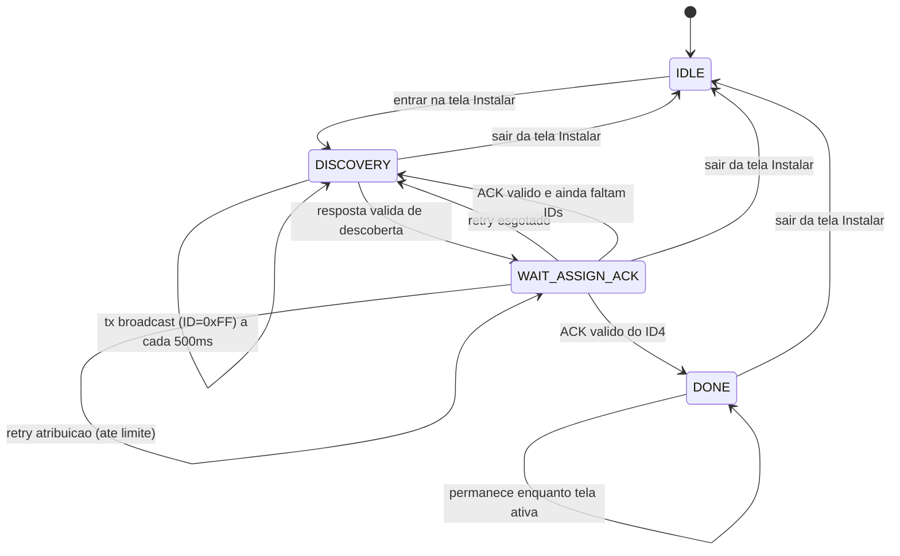
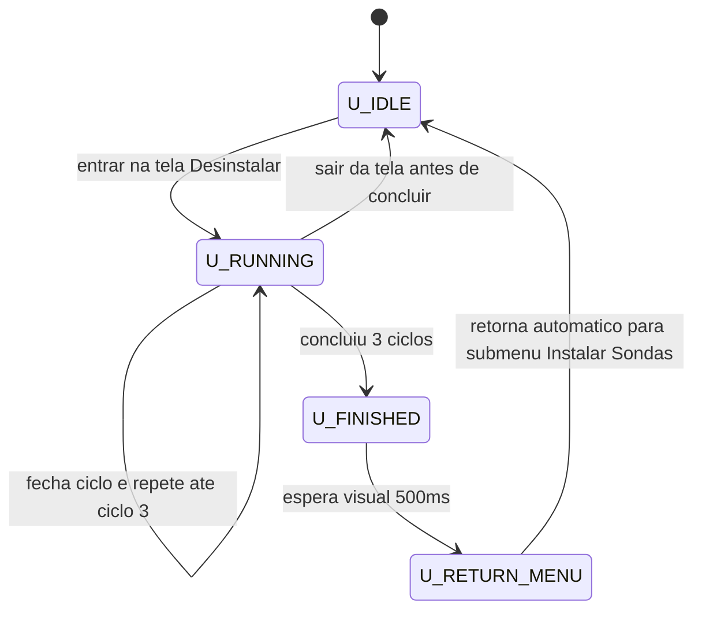
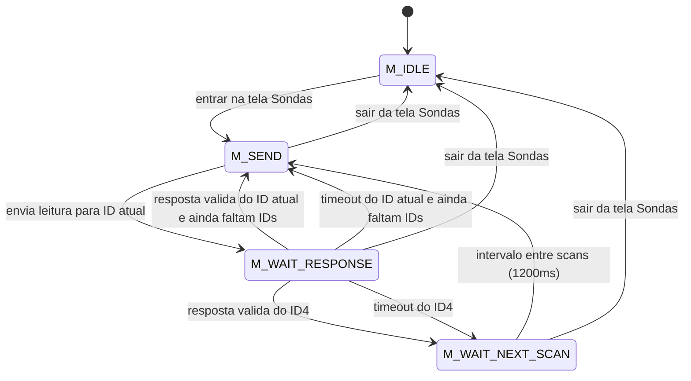
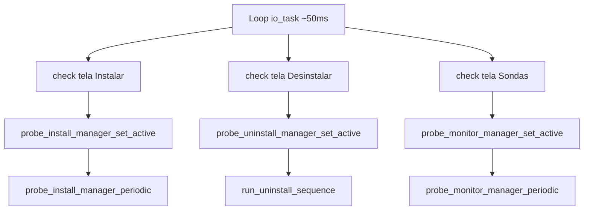
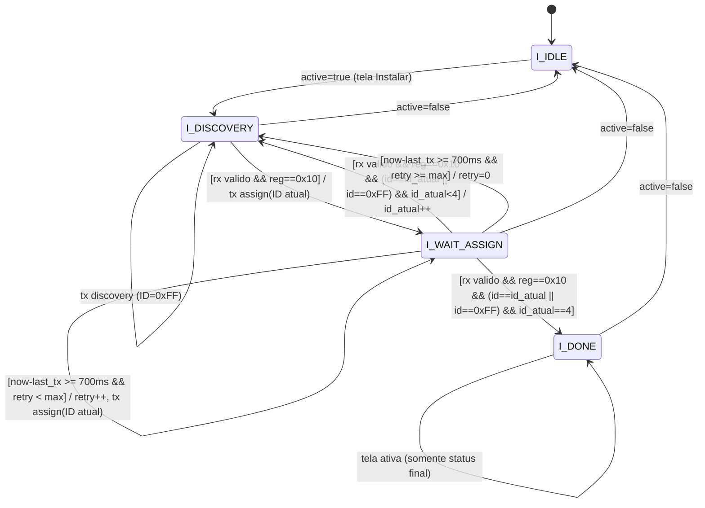
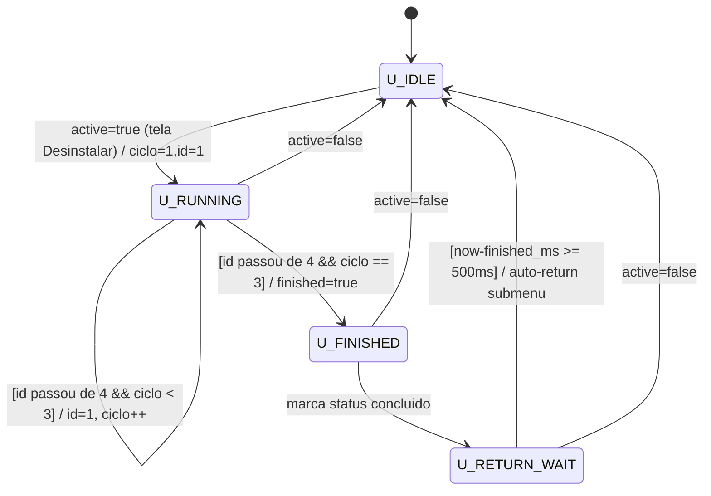
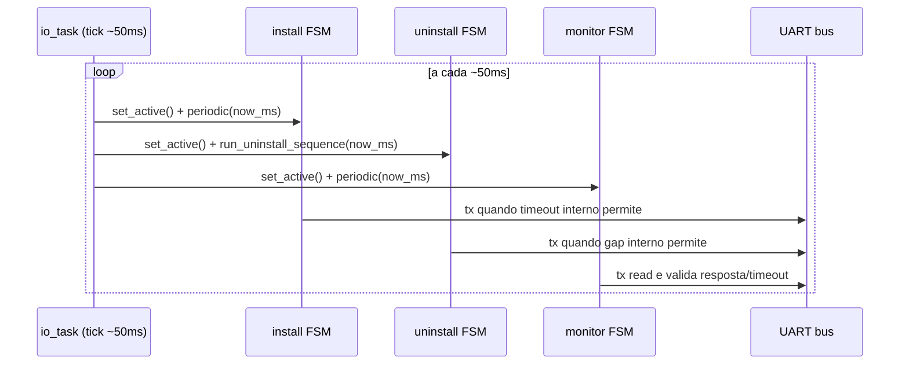

# Guia Tecnico - Secao de Sondas

Este guia descreve, em detalhe, como funciona a arquitetura da secao de sondas:
- instalacao por broadcast
- desinstalacao redundante
- polling ciclico de leitura
- sincronizacao com UI
- comportamento temporal das tasks/FSMs

## 1. Arquitetura Geral

### 1.1 Componentes
- `app_model.c/.h`
  - Estado global thread-safe via mutex.
  - Snapshot consumido pela UI.
  - Flags de tela ativa para ligar/desligar managers.
- `probe_install.c/.h`
  - Camada de protocolo UART.
  - CRC, framing, parser.
  - FSM de instalacao.
  - FSM de desinstalacao.
  - FSM de monitoramento de leitura (tela Sondas).
- `io_task.c`
  - Loop periodico que aciona os managers de forma nao bloqueante.
- `display_task.c`
  - Renderiza o snapshot atual (sem operar UART diretamente).

### 1.2 Filosofia
- UART e UI desacopladas.
- Nada de `while` bloqueante dentro das rotinas de sondas.
- Toda evolucao ocorre por ticks do scheduler no loop da `io_task`.

## 2. Protocolo de Frame UART

Formato de 9 bytes:
1. Byte 0  : `0x55` (inicio)
2. Byte 1  : versao (atual `0x01`)
3. Byte 2  : tamanho do payload
4. Byte 3  : registrador/comando
5. Byte 4  : ID/alvo
6. Byte 5  : reservado
7. Byte 6  : CRC low
8. Byte 7  : CRC high
9. Byte 8  : `0x55` (fim)

CRC:
- Algoritmo: CRC-16 Modbus
- Base de calculo: bytes da versao ate o reservado (sem delimitadores)

Registradores usados:
- `0x10`: instalacao/configuracao
- `0x20`: leitura de telemetria

## 3. Instalacao por Broadcast (Tela Instalar)

### 3.1 Fluxo
1. Ao entrar na tela, `probe_install_manager_set_active(true)` arma a FSM.
2. FSM entra em `PROBE_STAGE_DISCOVERY`.
3. Envia frame ciclico com ID `0xFF` (`send_probe_discovery`).
4. Ao detectar resposta valida:
   - envia atribuicao para ID atual (1..4) com `send_probe_assignment`.
5. Aguarda ACK da atribuicao (`PROBE_STAGE_WAIT_ASSIGN_ACK`).
6. Se sucesso:
   - atualiza snapshot da sonda
   - incrementa contador concluido
   - avanca para o proximo ID
7. Se timeout/silencio:
   - realiza retries (limite configurado)
   - se exceder, volta para descoberta para evitar travamento.

### 3.2 Funcoes-chave
- `probe_install_manager_set_active(bool active)`
- `probe_install_manager_periodic(uint32_t now_ms)`
- `send_probe_discovery(void)`
- `send_probe_assignment(uint8_t id)`

## 4. Desinstalacao Redundante (Tela Desinstalar)

### 4.1 Objetivo
Forcar retorno de todos os sensores para estado virgem (ID = `0xFF`) com redundancia para barramento ruidoso.

### 4.2 Fluxo
1. Ao entrar na tela, `probe_uninstall_manager_set_active(true)` inicia contexto:
   - ciclo = 1
   - alvo = ID 1
2. `run_uninstall_sequence(now_ms)` e chamado periodicamente.
3. A cada `PROBE_UNINSTALL_GAP_MS` (80 ms):
   - envia frame de uninstall para alvo atual
   - avanca 1->2->3->4
4. Ao fechar ID 4:
   - incrementa ciclo
   - repete ate 3 ciclos completos
5. Ao concluir ciclo 3:
   - marca finalizado
   - aguarda `PROBE_UNINSTALL_RETURN_MS` (500 ms)
   - chama `app_model_exit_probe_uninstall_to_menu()` para retorno automatico.

### 4.3 Funcoes-chave
- `probe_uninstall_manager_set_active(bool active)`
- `run_uninstall_sequence(uint32_t now_ms)`
- `send_probe_uninstall(uint8_t target_id)`
- `build_probe_uninstall_frame(...)`

## 5. Polling de Leitura (Tela Sondas)

### 5.1 Fluxo
1. Ao entrar na tela, `probe_monitor_manager_set_active(true)`:
   - limpa buffer para placeholders
   - inicia no ID 1
2. FSM em `PROBE_MONITOR_SEND` envia leitura para ID atual.
3. FSM muda para `PROBE_MONITOR_WAIT_RESPONSE`.
4. Se resposta valida (reg e ID correspondentes):
   - parse de payload em T/U/S
   - atualiza `ProbeData` e snapshot do modelo
5. Se timeout (`100 ms`):
   - marca sensor como ausente
   - UI exibira `__._`
6. Apos ID 4:
   - entra em `PROBE_MONITOR_WAIT_NEXT_SCAN`
   - aguarda `1200 ms`
   - reinicia varredura no ID 1

### 5.2 Funcoes-chave
- `probe_monitor_manager_set_active(bool active)`
- `probe_monitor_manager_periodic(uint32_t now_ms)`
- `send_probe_read_request(uint8_t id)`
- `process_probe_response(...)`

### 5.3 Estrutura de dados local
`ProbeData`:
- `temp`
- `hum`
- `soil`
- `installed`

## 6. Renderizacao da UI

### 6.1 Tela Instalar
- Lista S1..S4 com T/U/S.
- Se sem leitura: `--.-`.
- Rodape com status de instalacao.

### 6.2 Tela Desinstalar
- Texto fixo: `Desinstalando...`
- Progresso: `Ciclo X/3`
- Ao terminar: `Concluido` (antes do auto-retorno)

### 6.3 Tela Sondas
- Linhas:
  - `Sensor 1: T:xx.x U:xx.x S:xx.x`
  - ...
- Em ausencia/timeout:
  - `Sensor N: T:__._ U:__._ S:__._`

## 7. Temporizacao e Tasking

### 7.1 Relogio base
- `io_task` executa loop com `vTaskDelay(50 ms)`.
- Esse loop fornece o tick de alto nivel para as FSMs.

### 7.2 Timeouts/periodos internos
- Descoberta instalacao: 500 ms
- Retry atribuicao: 700 ms
- Gap desinstalacao: 80 ms
- Delay visual pos-desinstalacao: 500 ms
- Timeout resposta monitor: 100 ms
- Gap entre envios do monitor: 30 ms
- Intervalo entre varreduras completas: 1200 ms

## 8. Como o sistema ativa/pausa rotinas

No loop de IO:
- `app_model_is_probe_install_screen_active()`
- `app_model_is_probe_uninstall_screen_active()`
- `app_model_is_probe_list_screen_active()`

Cada retorno habilita/desabilita o manager correspondente.
Resultado:
- saiu da tela, rotina pausa automaticamente
- voltou para a tela, rotina retoma/inicializa conforme caso

## 9. Pontos de extensao

1. Enderecamento externo por alvo
- `select_probe_target_address()` esta como hook.
- Implementar aqui se houver transceiver/protocolo com selecao de destino fora do payload.

2. Payload real da sonda
- `process_probe_response()` ja parseia um layout base (x10).
- Ajustar endianness/escala conforme firmware real da sonda.

3. Mapa de registradores
- Se o comando de leitura nao for `0x20`, alterar `PROBE_READ_REGISTER`.

## 10. Checklist de teste sugerido

1. Entrar em Instalar e observar progresso 0..4.
2. Confirmar saida da rotina ao sair da tela.
3. Entrar em Desinstalar e validar ciclo 1/3 ate 3/3.
4. Confirmar retorno automatico para submenu apos 500 ms.
5. Entrar em Sondas e validar alternancia valor real <-> `__._` conforme resposta/timeout.
6. Simular ruido/desconexao e validar que UI nao trava e continua navegavel.

## 11. Diagramas de Estados (FSM)

### 11.1 FSM de Instalacao

### 11.2 FSM de Desinstalacao

### 11.3 FSM de Polling da Tela Sondas

### 11.4 Orquestracao no Loop da io_task

## 12. Diagramas de Estados (FSM) - Versao Expandida

### 12.1 Instalacao (expandido com guards/eventos)

### 12.2 Desinstalacao (expandido com repeticoes)

### 12.3 Polling Sondas (expandido com timeout/CRC)

```mermaid
stateDiagram-v2
   [*] --> M_IDLE

   M_IDLE --> M_SEND: active=true (tela Sondas) / reset placeholders

   M_SEND --> M_SEND: [now-stage_start < 30ms]
   M_SEND --> M_WAIT: [now-stage_start >= 30ms] / tx read(id atual)

   M_WAIT --> M_SEND: [rx valido && reg==0x20 && id==id atual && id<4] / atualiza T,U,S; id++
   M_WAIT --> M_SCAN_GAP: [rx valido && reg==0x20 && id==id atual && id==4] / atualiza T,U,S

   M_WAIT --> M_SEND: [timeout 100ms && id<4] / marca ausente (__._), id++
   M_WAIT --> M_SCAN_GAP: [timeout 100ms && id==4] / marca ausente (__._)

   M_SCAN_GAP --> M_SCAN_GAP: [now-scan_end < 1200ms]
   M_SCAN_GAP --> M_SEND: [now-scan_end >= 1200ms] / id=1

   M_SEND --> M_IDLE: active=false
   M_WAIT --> M_IDLE: active=false
   M_SCAN_GAP --> M_IDLE: active=false
```

### 12.4 Fluxo temporal simplificado (tick de 50ms)

## 13. Tabela de Rastreabilidade (FSM -> Codigo)

### 13.1 Instalacao

| Estado/Evento (FSM) | Funcao/Codigo | Acao executada |
|---|---|---|
| Entrar em Instalar (`active=true`) | `probe_install_manager_set_active()` | Inicializa contexto de instalacao, zera contadores e status da UI |
| `I_DISCOVERY` (broadcast periodico) | `probe_install_manager_periodic()` + `send_probe_discovery()` | Envia frame com ID `0xFF` no periodo configurado |
| Resposta valida de descoberta | `probe_install_manager_periodic()` | Filtra por `reg==0x10` e avanca para atribuicao |
| `I_WAIT_ASSIGN` (tx de atribuicao) | `send_probe_assignment(id)` | Envia frame de atribuicao para ID atual |
| ACK valido de atribuicao | `probe_install_manager_periodic()` + `app_model_set_probe_snapshot()` | Atualiza dados da sonda e incrementa progresso |
| Retry de atribuicao | `probe_install_manager_periodic()` | Reenvia comando apos timeout de retry |
| Retry esgotado | `probe_install_manager_periodic()` | Retorna ao estado de descoberta |
| Conclusao ID4 (`I_DONE`) | `probe_install_manager_periodic()` + `app_model_set_probe_install_status()` | Marca instalacao finalizada (4/4) |
| Sair da tela Instalar (`active=false`) | `probe_install_manager_set_active()` | Pausa rotina sem bloquear sistema |

### 13.2 Desinstalacao

| Estado/Evento (FSM) | Funcao/Codigo | Acao executada |
|---|---|---|
| Entrar em Desinstalar (`active=true`) | `probe_uninstall_manager_set_active()` | Inicializa ciclo=1 e alvo ID=1 |
| `U_RUNNING` (gap entre frames) | `run_uninstall_sequence()` | Aguarda `PROBE_UNINSTALL_GAP_MS` de forma nao bloqueante |
| Tx por alvo (ID 1..4) | `run_uninstall_sequence()` + `send_probe_uninstall()` | Envia reset para estado virgem (`0xFF`) |
| Fechamento de ciclo | `run_uninstall_sequence()` | Reinicia alvo em 1 e incrementa ciclo |
| Conclusao apos 3 ciclos | `run_uninstall_sequence()` + `app_model_set_probe_uninstall_status()` | Marca finalizado e inicia delay visual |
| Auto-retorno ao submenu | `run_uninstall_sequence()` + `app_model_exit_probe_uninstall_to_menu()` | Volta para "Instalar Sondas" apos 500ms |
| Sair da tela Desinstalar (`active=false`) | `probe_uninstall_manager_set_active()` | Interrompe/pauseia a rotina |

### 13.3 Polling da tela Sondas

| Estado/Evento (FSM) | Funcao/Codigo | Acao executada |
|---|---|---|
| Entrar em Sondas (`active=true`) | `probe_monitor_manager_set_active()` | Inicia FSM de monitoramento e carrega placeholders |
| `M_SEND` | `probe_monitor_manager_periodic()` + `send_probe_read_request(id)` | Envia leitura para ID atual |
| `M_WAIT_RESPONSE` (resposta valida) | `probe_monitor_manager_periodic()` + `process_probe_response()` | Valida `reg/id`, parseia payload e atualiza T/U/S |
| Timeout de resposta | `probe_monitor_manager_periodic()` + `app_model_set_probe_snapshot()` | Marca sensor ausente (`__._` na UI) |
| Fim da varredura (ID4) | `probe_monitor_manager_periodic()` | Entra em `M_WAIT_NEXT_SCAN` |
| Gap entre varreduras | `probe_monitor_manager_periodic()` | Aguarda `PROBE_MONITOR_SCAN_PERIOD_MS` |
| Reinicio da varredura | `probe_monitor_manager_periodic()` | Retorna ao ID=1 |
| Sair da tela Sondas (`active=false`) | `probe_monitor_manager_set_active()` | Pausa polling e libera barramento |

### 13.4 Framing, CRC e Parse

| Responsabilidade | Funcao/Codigo | Detalhe |
|---|---|---|
| Montagem de frame generico | `build_probe_frame(reg,id,reserved,...)` | Gera frame padrao de 9 bytes |
| CRC-16 | `crc16_modbus()` | Protege frame contra erro de transmissao |
| Frame de uninstall | `build_probe_uninstall_frame()` | Reaproveita frame padrao gravando ID `0xFF` |
| Parse/validacao de frame | `parse_probe_frame()` | Valida delimitadores, tamanho e CRC |
| Captura de frame no RX | `uart_read_probe_frame()` | Extrai frame valido do buffer UART |

### 13.5 Orquestracao no scheduler

| Ponto de integracao | Funcao/Codigo | Papel |
|---|---|---|
| Tick periodico de 50ms | `io_task()` | Relogio base das FSMs |
| Ativacao por tela | `app_model_is_probe_*_screen_active()` | Liga/desliga cada manager por contexto visual |
| Execucao das rotinas | `probe_install_manager_periodic()` / `run_uninstall_sequence()` / `probe_monitor_manager_periodic()` | Mantem operacao assincrona e UI responsiva |
