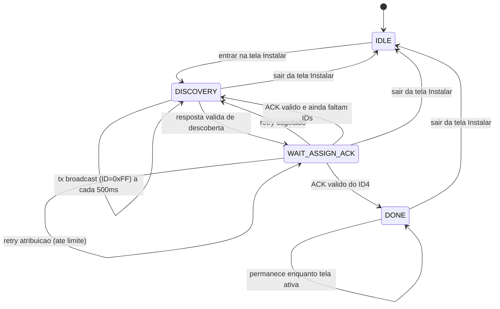
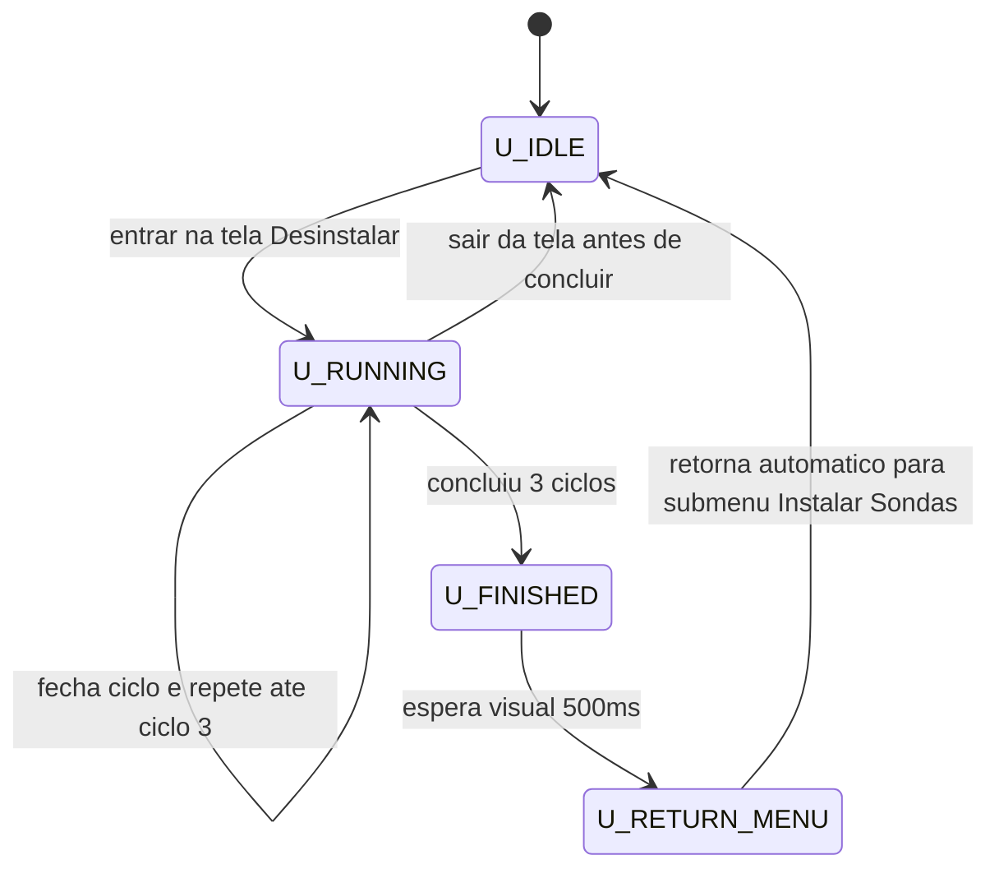
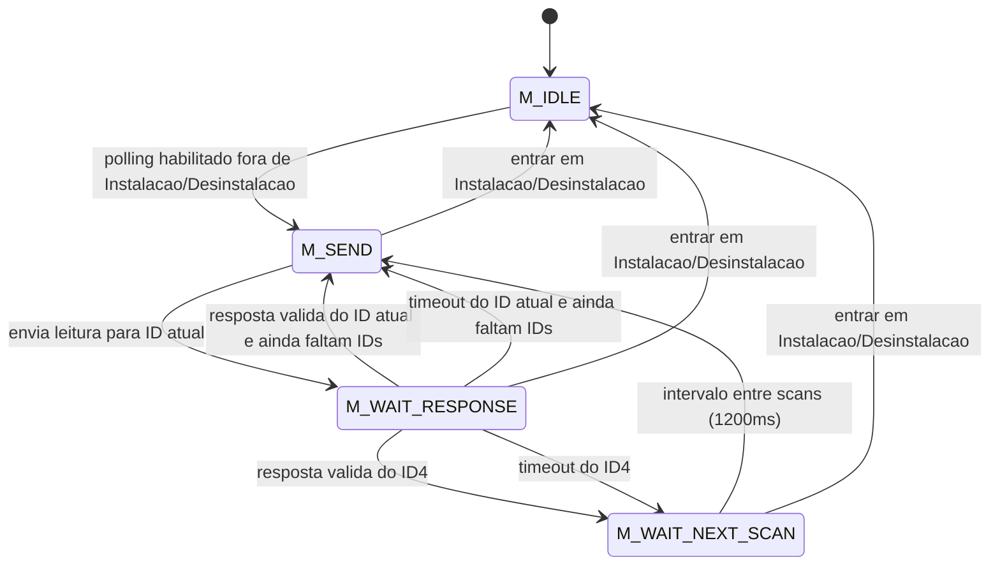
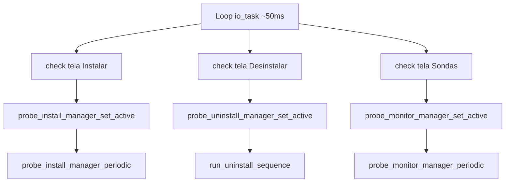
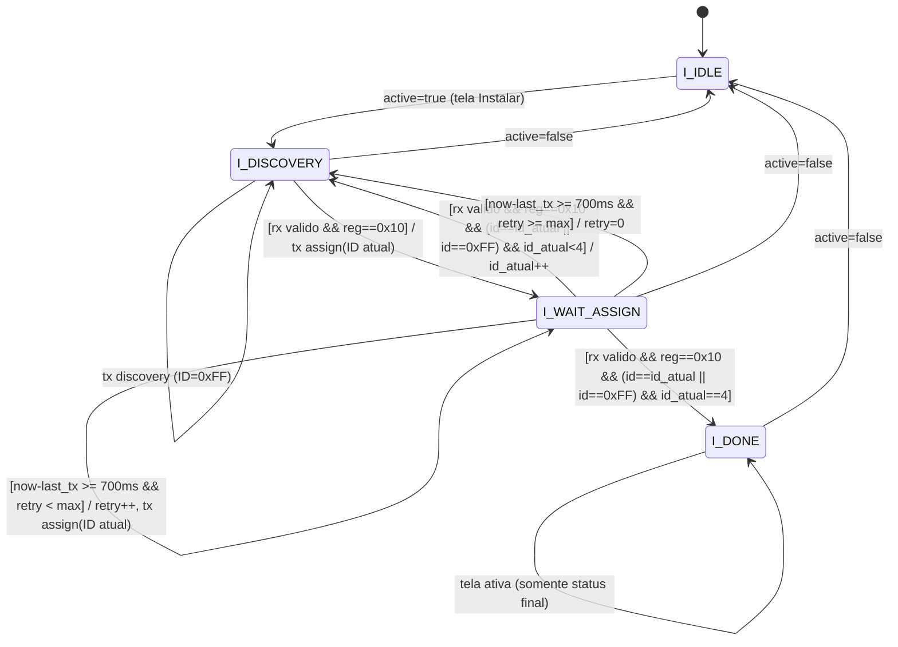
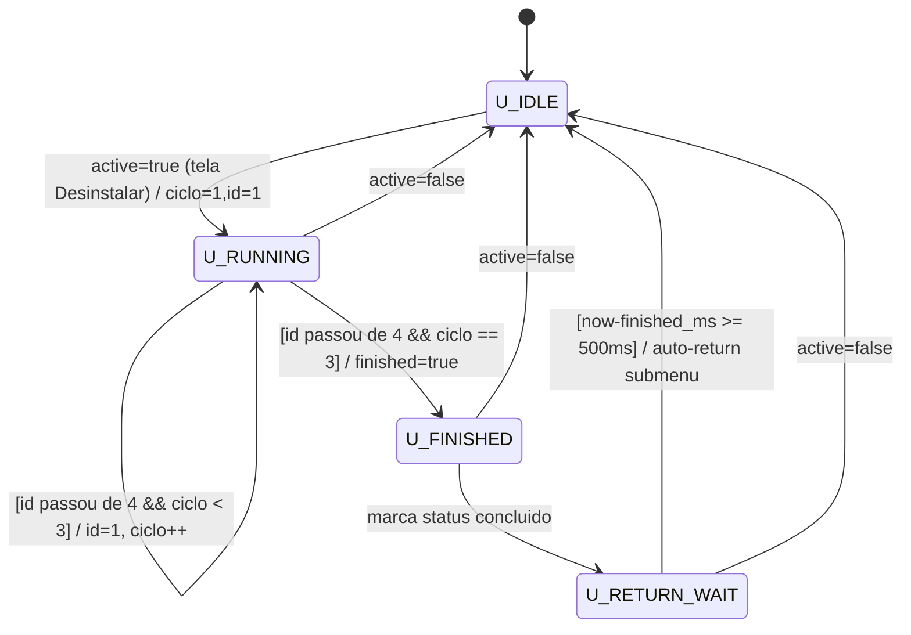
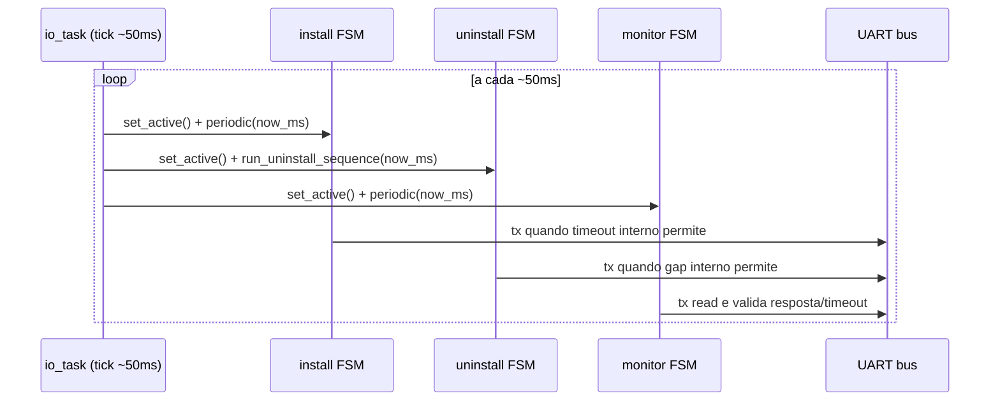

# Guia Tecnico - Secao de Sondas

Este guia descreve, em detalhe, como funciona a arquitetura da secao de sondas:
- instalacao por broadcast
- desinstalacao redundante
- polling ciclico de leitura
- sincronizacao com UI
- comportamento temporal das tasks/FSMs

Referencia de bancada, conferida com os firmwares em 2026-10-22:
- [Formato, tamanho e CRC](#21-configuracao-e-formato)
- [Broadcast de descoberta e resposta](#23-broadcast-de-descoberta-0x11)
- [Instalacao S1 a S4](#24-atribuicao-de-id-0x10)
- [ACK atual e ACK legado](#25-ack-de-instalacao)
- [Desinstalacao S1 a S4](#26-desinstalacao-0x12)
- [Leitura e respostas S1 a S4](#27-consulta-de-leitura-0x20)
- [Decodificacao das medicoes](#28-payload-de-telemetria)
- [Sequencia completa de captura](#29-sequencia-completa-para-s1)
- [Tempos, DE-RE e diagnostico](#210-tempos-e-direcao-do-barramento)

## 1. Arquitetura Geral

## Correcao de comunicacao de 2026-10-22

- A central preserva respostas UART fragmentadas entre os ticks da task de IO.
   Antes, uma leitura parcial era consumida e descartada, perdendo ACK/telemetria.
- Frames completos so sao entregues apos validar versao, tamanho e CRC.
   Frames consecutivos nao sao descartados junto com o primeiro.
- Na sonda TTU, USART1 recebe por interrupcao e guarda ate 127 bytes enquanto
   o loop atende o SHT30. A resposta aguarda 2 ticks de 1 ms antes de elevar PA8;
   PA8 so volta a zero depois de TC, incluindo o ultimo stop bit.
- Repetir a atribuicao do mesmo ID reenvia o ACK sem regravar a flash.
- O ACK TTU de instalacao agora inclui 6 bytes de telemetria, como a resposta
   `0x20`: temperatura do ar, umidade do ar e umidade do solo, em decimos.
   A central continua aceitando ACK legado sem payload e o layout de 8 bytes.
- O snapshot inicial da TTU e zero ate a primeira amostragem valida do SHT30.
   A central atualiza as leituras em background, exceto durante instalacao ou
   desinstalacao, quando a UART e usada exclusivamente por esses fluxos.
   Solo ainda nao possui sensor implementado na TTU; umidade e placeholder e a
   central replica temperatura do ar quando nao recebe temperatura de solo.

### Teste host da central

Executar na raiz de `smart-horta` (requer compilador C no Linux):

```sh
sed '/^#include /d' components/app_io/probe_install.c | cc -std=c11 -Wall -Wextra -Werror -Wno-unused-variable -fsanitize=address,undefined -include "$PWD/tests/host/test_probe_install.c" -x c - -o /tmp/test-probe-install
/tmp/test-probe-install
```

O teste compila a implementacao real com substitutos das APIs ESP-IDF/modelo.
Cobre ACK legado e ACK com leituras fragmentados, telemetria byte a byte,
frames consecutivos, CRC invalido, instalacao e polling. Nao substitui build
ESP-IDF nem validacao eletrica.

### Validacao em bancada

1. Recompilar e gravar os dois firmwares, central e sonda.
2. Conferir GPIO4 da central e PA8 da TTU ligados a DE e /RE dos respectivos
    transceivers: alto transmite, baixo recebe. Manter GND comum.
3. Desinstalar e reinstalar com somente uma sonda virgem no barramento.
4. No osciloscopio, consultar PA8 e PA9: apos a central liberar o barramento,
    PA8 deve subir durante a resposta e cair somente depois do ultimo stop bit.
    Descoberta tem 9 bytes; ACK TTU e leitura tem 15 bytes (aprox. 15,6 ms em 9600 8N1).
5. Abrir Sondas e verificar atualizacoes de temperatura/umidade do ar apos a
    primeira amostragem. O LED apagado sozinho nao comprova recebimento do ACK.

## 0. Atualizacao de 2026-10-14

Esta revisao adiciona os seguintes comportamentos solicitados para a UX de campo:
- Cada sonda agora possui identidade explicita no modelo (`probe_id`) e tipo (`probe_type`).
- Telemetria passou a considerar 4 grandezas por sonda:
   - temperatura do ar
   - umidade do ar
   - temperatura do solo
   - umidade do solo
- Tela HOME foi reorganizada para mostrar:
   - aviso de alarmes ativos no topo
   - data/hora logo abaixo
   - medias das leituras das sondas instaladas (ar e solo)
- Tecla ESQUERDA na HOME abre uma tela direta de sondas instaladas.
- Telas de Instalacao e Sondas passaram a usar fonte padrao com layout abreviado (`S1`, `S2`, ...).
- Na Instalacao, o rodape exibe barra ciclica de progresso enquanto instala.
   - ao finalizar todas as sondas, a barra deixa de ser renderizada.

## 0.1 Tipos de sonda (estado atual)

O modelo agora explicita o tipo de cada sonda via `probe_type`, permitindo que a
mesma arquitetura suporte novos sensores sem quebrar as telas existentes.

Mapa atual de tipos:
- `APP_PROBE_TYPE_UNKNOWN (0)`
   - fallback para dados sem classificacao.
- `APP_PROBE_TYPE_AIR_SOIL_TH (1)`
   - perfil atual em producao.
   - leituras: temperatura do ar, umidade do ar, temperatura do solo, umidade do solo.

Campos de identidade por sonda no snapshot:
- `probe_id`: identifica a sonda no barramento (faixa atual 1..4).
- `probe_type`: identifica o perfil funcional da sonda.

### 1.1 Componentes
- `app_model.c/.h`
  - Estado global thread-safe via mutex.
  - Snapshot consumido pela UI.
  - Flags de tela ativa para ligar/desligar managers.
   - Nova tela dedicada de sondas a partir da HOME (`APP_SCREEN_HOME_PROBES`).
   - Snapshot de sonda com `probe_id`, `probe_type`, `air_temperature`, `air_humidity`, `soil_temperature`, `soil_humidity`.
- `probe_install.c/.h`
  - Camada de protocolo UART.
  - CRC, framing, parser.
  - FSM de instalacao.
  - FSM de desinstalacao.
  - FSM de monitoramento de leitura (tela Sondas).
- `io_task.c`
  - Loop periodico que aciona os managers de forma nao bloqueante.
- `display_task.c`
  - Renderiza o snapshot atual (sem operar UART diretamente).

### 1.2 Filosofia
- UART e UI desacopladas.
- Nada de `while` bloqueante dentro das rotinas de sondas.
- Toda evolucao ocorre por ticks do scheduler no loop da `io_task`.

## 2. Protocolo de Frame UART

### 2.1 Configuracao e formato

UART: **9600 baud, 8 bits, sem paridade, 1 stop bit (8N1)**, sem controle de
fluxo. No TX/RX logico, repouso alto, start bit baixo, dados LSB primeiro e
decodificacao nao invertida. O enlace e RS485 half-duplex com controle DE-/RE.
Este e um protocolo proprio: somente o algoritmo de CRC e o do Modbus.

Todos os numeros nos frames abaixo estao em **hexadecimal**. Cada par representa
um byte binario; nao transmitir o texto ASCII `55 01 ...` por um terminal serial.
S1 a S4 correspondem aos IDs `01` a `04`; `FF` representa a sonda desinstalada.

```text
55 01 LL RR ID 00 [DADOS...] CRC_LO CRC_HI 55
```

| Offset, em decimal | Campo | Significado |
|---|---|---|
| 0 | `55` | Delimitador inicial. |
| 1 | `01` | Versao do protocolo. |
| 2 | `LL` | Tamanho de registrador + ID + reservado + dados. |
| 3 | `RR` | Registrador/comando. |
| 4 | `ID` | Alvo no comando; identidade da sonda na resposta. |
| 5 | `00` | Reservado; os emissores atuais enviam zero. |
| 6 em diante | Dados opcionais | Medicoes, quando presentes. |
| Total - 3 | `CRC_LO` | Byte menos significativo do CRC. |
| Total - 2 | `CRC_HI` | Byte mais significativo do CRC. |
| Total - 1 | `55` | Delimitador final. |

**LL nao e o tamanho total do frame, nem apenas o tamanho das medicoes.**
Se ha D bytes de dados, LL = 3 + D e o tamanho total e LL + 6 = 9 + D.

| Uso | Dados | LL | Total |
|---|---:|---|---:|
| Comandos, descoberta/resposta e ACK legado | 0 bytes | `03` | 9 bytes |
| ACK atual TTU e resposta atual de leitura | 6 bytes | `09` | 15 bytes |
| Layout estendido aceito pela central | 8 bytes | `0B` | 17 bytes |

Os bytes `55` podem aparecer nos dados ou no CRC; nao existe escape de bytes.
Para separar frames, respeitar LL, o delimitador final e o CRC, nao apenas procurar
o proximo `55`. Nao ha numero de transacao nem bit que diferencie TX de resposta.

### 2.2 Calculo de CRC e registradores

CRC-16/Modbus: inicial `FFFF`, polinomio refletido `A001`, processamento LSB
primeiro e sem XOR final. Calcular sobre **versao + LL + registrador + ID +
reservado + todos os dados**. Excluir delimitadores e os proprios bytes de CRC.
Enviar o resultado em little-endian: CRC_LO antes de CRC_HI.

Exemplo de descoberta: calcular sobre `01 03 11 FF 00`; o resultado numerico e
`7108`, transmitido como `08 71`. Se alterar ID, opcode, tamanho ou medicoes,
recalcular o CRC. Os exemplos abaixo ja incluem CRC valido.

| Registrador | Central para sonda | Sonda para central |
|---|---|---|
| `10` | Atribuir ID `01` a `04`. | ACK com o ID atribuido; TTU atual inclui medicoes. |
| `11` | Descoberta broadcast, ID `FF`. | Resposta de sonda virgem, ID `FF`. |
| `12` | Desinstalar o ID indicado. | **Nenhuma resposta/ACK implementado.** |
| `20` | Consultar medicoes do ID indicado. | Resposta com medicoes e o mesmo ID. |

Nao existe frame NACK/erro. CRC invalido, frame invalido, registrador desconhecido
ou comando nao aplicavel ao estado/ID sao ignorados em silencio.

### 2.3 Broadcast de descoberta (0x11)

| Direcao | Frame completo |
|---|---|
| Central para todas | `55 01 03 11 FF 00 08 71 55` |
| Sonda virgem para central | `55 01 03 11 FF 00 08 71 55` |

Somente sondas com ID persistido `FF` respondem. Uma sonda instalada fica em
silencio; a descoberta nao instala, nao apaga ID e nao e consulta de telemetria.
Comando e resposta sao identicos: confirmar a direcao pelo DE e pelo instante da
captura. Ver uma copia no RX durante o TX da central pode ser eco, nao resposta.

**Conectar apenas uma sonda virgem por vez.** Nao ha arbitragem, numero de serie
ou atraso aleatorio: sondas virgens simultaneas podem responder juntas e aceitar
o mesmo ID. A central repete a descoberta a cada 500 ms enquanto procura sondas.

### 2.4 Atribuicao de ID (0x10)

| Alvo a instalar | Frame central para sonda |
|---|---|
| S1 | `55 01 03 10 01 00 19 D1 55` |
| S2 | `55 01 03 10 02 00 19 21 55` |
| S3 | `55 01 03 10 03 00 18 B1 55` |
| S4 | `55 01 03 10 04 00 1A 81 55` |

Uma sonda virgem grava o ID em sua flash interna e responde com ACK. Uma sonda
que ja tem o mesmo ID reenvia o ACK, sem nova gravacao; uma instalada com ID
diferente ignora o comando. Exemplo: instalar S2 nao renomeia uma S1 existente.
Se a gravacao inicial reportar falha, o firmware nao envia ACK.

A central envia uma atribuicao inicial e ate 5 retries, separados por 700 ms.
Esgotado o limite sem ACK, volta a descoberta. O LED mudar de estado na sonda nao
comprova que a central recebeu/validou o ACK.

### 2.5 ACK de instalacao

O ACK usa registrador `10` e o ID atribuido. A TTU atual responde com 15 bytes,
incluindo o snapshot de 6 bytes descrito na secao 2.8. O CRC depende das medicoes;
nao comparar uma resposta real com um exemplo de valores diferentes.

Exemplos completos com **23,4 graus C, 55,5% de umidade do ar e solo 0,0%**:

| Sonda | ACK atual, sonda para central |
|---|---|
| S1 | `55 01 09 10 01 00 EA 00 2B 02 00 00 60 D5 55` |
| S2 | `55 01 09 10 02 00 EA 00 2B 02 00 00 20 C0 55` |
| S3 | `55 01 09 10 03 00 EA 00 2B 02 00 00 E1 0C 55` |
| S4 | `55 01 09 10 04 00 EA 00 2B 02 00 00 A0 EA 55` |

Antes da primeira amostragem valida, o snapshot pode estar zerado:

| Sonda | ACK atual com todos os dados zero |
|---|---|
| S1 | `55 01 09 10 01 00 00 00 00 00 00 00 DE 3B 55` |
| S2 | `55 01 09 10 02 00 00 00 00 00 00 00 9E 2E 55` |
| S3 | `55 01 09 10 03 00 00 00 00 00 00 00 5F E2 55` |
| S4 | `55 01 09 10 04 00 00 00 00 00 00 00 1E 04 55` |

**ACK legado:** 9 bytes, sem medicoes, exatamente os mesmos bytes do comando de
atribuicao de cada ID na secao 2.4. A central ainda o aceita, mas ele nao fornece
leituras para a tela de instalacao. Confirmar a direcao para nao aceitar um eco
como evidencia de comunicacao bidirecional. A TTU atual nao emite esse ACK curto.

### 2.6 Desinstalacao (0x12)

| Alvo | Frame central para sonda | Resposta esperada |
|---|---|---|
| S1 | `55 01 03 12 01 00 B8 11 55` | Silencio. |
| S2 | `55 01 03 12 02 00 B8 E1 55` | Silencio. |
| S3 | `55 01 03 12 03 00 B9 71 55` | Silencio. |
| S4 | `55 01 03 12 04 00 BB 41 55` | Silencio. |

Somente a sonda instalada com o ID alvo volta a `FF`, grava esse estado e acende
o LED. Nao ha desinstalacao broadcast `12 FF` implementada: a central percorre
S1, S2, S3, S4 e repete a sequencia 3 vezes, totalizando 12 comandos.
O intervalo configurado entre comandos e 80 ms, observado nos ticks da task.

**Nao esperar ACK de desinstalacao.** Para verificar o resultado, com uma unica
sonda em teste, enviar descoberta `11 FF`: ela deve responder novamente. Uma
consulta `20` ao ID antigo deve ficar sem resposta. Para comprovar persistencia
do estado, repetir a verificacao apos reiniciar a sonda.

### 2.7 Consulta de leitura (0x20)

| Sonda | Comando central para sonda |
|---|---|
| S1 | `55 01 03 20 01 00 19 DE 55` |
| S2 | `55 01 03 20 02 00 19 2E 55` |
| S3 | `55 01 03 20 03 00 18 BE 55` |
| S4 | `55 01 03 20 04 00 1A 8E 55` |

Somente a sonda instalada com o ID consultado responde. Sonda virgem ou de outro
ID fica em silencio; `20 FF` nao e leitura broadcast implementada. A resposta de
telemetria ja e a resposta final: nao existe ACK separado antes/depois dela, nem
confirmacao adicional enviada pela central.

Respostas completas para **23,4 graus C, 55,5% de umidade do ar e solo 0,0%**:

| Sonda | Resposta sonda para central |
|---|---|
| S1 | `55 01 09 20 01 00 EA 00 2B 02 00 00 34 D4 55` |
| S2 | `55 01 09 20 02 00 EA 00 2B 02 00 00 74 C1 55` |
| S3 | `55 01 09 20 03 00 EA 00 2B 02 00 00 B5 0D 55` |
| S4 | `55 01 09 20 04 00 EA 00 2B 02 00 00 F4 EB 55` |

### 2.8 Payload de telemetria

Os dados comecam no offset 6, tanto no ACK atual `10` como na resposta `20`.
Todos os valores sao inteiros em decimos, little-endian. Dividir por 10 para
obter graus C ou porcentagem.

| Offset no frame | Tipo | TTU atual, 6 bytes de dados |
|---|---|---|
| 6, 7 | int16 com sinal | Temperatura do ar x10. |
| 8, 9 | uint16 sem sinal | Umidade do ar x10. |
| 10, 11 | uint16 sem sinal | Umidade do solo x10. |
| 12, 13 | CRC | CRC_LO, CRC_HI. |
| 14 | Delimitador | `55`. |

No exemplo das tabelas: `EA 00` = 234 = 23,4 graus C; `2B 02` = 555 = 55,5%;
`00 00` = 0 = 0,0%. A TTU atual **ainda nao mede umidade do solo**: envia zero
como placeholder. Tambem nao transmite temperatura de solo; a central replica
a temperatura do ar nesse campo. Isso nao e medicao real de temperatura do solo.

Temperatura negativa usa complemento de dois. Exemplo S1 com -5,2 graus C,
55,5% de umidade do ar e solo 0,0%: `CC FF` = int16(-52).

```text
55 01 09 20 01 00 CC FF 2B 02 00 00 27 C6 55
```

A central tambem aceita um layout de 8 bytes de dados: temperatura do ar int16,
umidade do ar uint16, temperatura do solo int16 e umidade do solo uint16,
nessa ordem, todos x10 e little-endian. LL = `0B`, total = 17 bytes.
**A TTU atual nao emite esse layout.** Exemplo sintetico de compatibilidade para
S1: ar 23,4 graus C / 55,5%; solo 21,0 graus C / 40,0%:

```text
55 01 0B 20 01 00 EA 00 2B 02 D2 00 90 01 7B E0 55
```

### 2.9 Sequencia completa para S1

Exemplo com uma sonda inicialmente virgem. As medicoes abaixo sao ilustrativas;
em bancada o snapshot e o CRC podem variar.

| Passo | Emissor | Frame capturado |
|---|---|---|
| 1. Descoberta | Central | `55 01 03 11 FF 00 08 71 55` |
| 2. Resposta virgem | Sonda | `55 01 03 11 FF 00 08 71 55` |
| 3. Atribuir S1 | Central | `55 01 03 10 01 00 19 D1 55` |
| 4. ACK com snapshot | Sonda | `55 01 09 10 01 00 EA 00 2B 02 00 00 60 D5 55` |
| 5. Consultar S1 | Central | `55 01 03 20 01 00 19 DE 55` |
| 6. Resposta de leitura | Sonda | `55 01 09 20 01 00 EA 00 2B 02 00 00 34 D4 55` |
| 7. Desinstalar S1 | Central | `55 01 03 12 01 00 B8 11 55` |
| 8. Sem ACK | Sonda | Nenhum frame. |
| 9. Nova descoberta | Central | `55 01 03 11 FF 00 08 71 55` |
| 10. Resposta virgem | Sonda | `55 01 03 11 FF 00 08 71 55` |

Na interface, a leitura ciclica fica ativa em background, inclusive fora da
tela Sondas e sem lote, exceto durante instalacao/desinstalacao. A tela Instalar
publica o snapshot do ACK e segue procurando as outras sondas; o polling continuo
comeca assim que a tela de instalacao e fechada. Para capturar os passos 5 e 6
pelo menu, abrir Sondas apos instalar.

### 2.10 Tempos e direcao do barramento

| Parametro | Referencia para captura |
|---|---|
| Tempo de bit em 9600 baud | Aproximadamente 104,17 us. |
| Tempo de byte em 8N1, 10 bits | Aproximadamente 1,042 ms. |
| Frame de 9 bytes | Aproximadamente 9,375 ms, sem pausas adicionais. |
| Frame de 15 bytes | Aproximadamente 15,625 ms, sem pausas adicionais. |
| Frame de 17 bytes | Aproximadamente 17,708 ms, sem pausas adicionais. |
| Guarda TTU antes de elevar DE | 2 ticks de 1 ms; alinhamento ao tick altera o tempo observado. |
| Timeout de resposta da central | 100 ms desde a referencia do envio na FSM de leitura. |
| Tick da task de I/O | Cerca de 50 ms, mais trabalho e eventuais acessos a flash. |
| Descoberta / retry de atribuicao | 500 ms / 700 ms; ate 5 retries de atribuicao. |
| Intervalo minimo configurado entre consultas | 30 ms, observado no tick da task. |
| Pausa apos consultar S4 | 1200 ms antes de novo scan. |
| Desinstalacao | 3 ciclos S1 a S4, intervalo configurado de 80 ms. |
| Parser de entrada TTU | Descarta frame parcial apos 30 ms sem progresso no processamento. |
| Amostragem do SHT30 | Uma tentativa por segundo; conserva o ultimo valor valido. |

O atraso de resposta nao e exatamente 2 ms apos o comando: o firmware primeiro
precisa processa-lo, pode estar atendendo sensor e, na instalacao, grava o ID na
flash antes de enviar ACK. Os intervalos das FSMs tambem sao quantizados pelo
loop de I/O, nao por um temporizador que garante o instante exato no fio.

| Ponto | RX/repouso | TX | O que observar |
|---|---|---|---|
| Central GPIO4, DE e /RE juntos | 0 | 1 | Alto durante comando; baixo para receber resposta. |
| TTU PA8, DE e /RE juntos | 0 | 1 | Alto durante resposta; baixo somente apos TC/ultimo stop bit. |
| Central TX17 / RX16 | UART logica | UART logica | Comando em TX17 e resposta em RX16. |
| TTU PA9 / PA10 | UART logica | UART logica | Comando recebido em PA10 e resposta enviada em PA9. |

Usar GND comum e conferir A/B dos transceivers. A/B e um par diferencial, nao
uma UART TTL: para decodificacao logica, observar TX/RX dos microcontroladores
ou DI/RO do transceiver, com instrumento e niveis eletricos apropriados.

### 2.11 Diagnostico rapido

| Captura/sintoma | Interpretacao e proxima verificacao |
|---|---|
| Descoberta TX sem resposta | A sonda pode ja estar instalada; conferir LED/ID antes de concluir falha eletrica. |
| Instalacao repete a cada 700 ms, LED muda | Comando chegou, mas ACK pode nao ter chegado/validado na central; conferir PA8, PA9, RX16 e CRC. |
| Bytes em PA9, mas nada em RX16 | Conferir DE-/RE, transceivers, alimentacao, A/B e GND. |
| Sem pulso em PA8 apos comando valido | Conferir opcode, ID e estado instalado/virgem; comandos ignorados nao geram resposta. |
| Copia identica durante TX da central | Pode ser eco; descoberta e ACK legado sao identicos aos comandos. Conferir DE e timestamps. |
| Desinstalacao sem resposta | Comportamento normal; verificar com nova descoberta ou consulta ao ID antigo. |
| Telemetria valida, mas toda zerada | UART respondeu; conferir primeira amostragem, sensor SHT30 e comunicacao I2C. |
| Leitura de solo sempre zero ou temperatura igual ao ar | Limitacao atual da TTU, nao prova falha RS485. |
| Sonda instalada nao responde descoberta | Comportamento normal; consultar `20` com o ID instalado. |
| Resposta aparece em partes no log | Bytes UART podem chegar fragmentados; juntar pelo tamanho antes de verificar CRC. |

Fontes da referencia: [central](../components/app_io/probe_install.c),
[protocolo TTU](../../sonda-horta/sonda-ttu/Src/probe_protocol.c) e
[UART/DE da TTU](../../sonda-horta/sonda-ttu/Src/peripherals_init.c).

## 3. Instalacao por Broadcast (Tela Instalar)

### 3.1 Fluxo
1. Ao entrar na tela, `probe_install_manager_set_active(true)` arma a FSM.
2. FSM entra em `PROBE_STAGE_DISCOVERY`.
3. Envia frame ciclico com ID `0xFF` (`send_probe_discovery`).
4. Ao detectar resposta valida:
   - envia atribuicao para ID atual (1..4) com `send_probe_assignment`.
5. Aguarda ACK da atribuicao (`PROBE_STAGE_WAIT_ASSIGN_ACK`).
6. Se sucesso:
   - atualiza snapshot da sonda
   - incrementa contador concluido
   - avanca para o proximo ID
7. Se timeout/silencio:
   - realiza retries (limite configurado)
   - se exceder, volta para descoberta para evitar travamento.

### 3.2 Funcoes-chave
- `probe_install_manager_set_active(bool active)`
- `probe_install_manager_periodic(uint32_t now_ms)`
- `send_probe_discovery(void)`
- `send_probe_assignment(uint8_t id)`

## 4. Desinstalacao Redundante (Tela Desinstalar)

### 4.1 Objetivo
Forcar retorno de todos os sensores para estado virgem (ID = `0xFF`) com redundancia para barramento ruidoso.

### 4.2 Fluxo
1. Ao entrar na tela, `probe_uninstall_manager_set_active(true)` inicia contexto:
   - ciclo = 1
   - alvo = ID 1
2. `run_uninstall_sequence(now_ms)` e chamado periodicamente.
3. A cada `PROBE_UNINSTALL_GAP_MS` (80 ms):
   - envia frame de uninstall para alvo atual
   - avanca 1->2->3->4
4. Ao fechar ID 4:
   - incrementa ciclo
   - repete ate 3 ciclos completos
5. Ao concluir ciclo 3:
   - marca finalizado
   - aguarda `PROBE_UNINSTALL_RETURN_MS` (500 ms)
   - chama `app_model_exit_probe_uninstall_to_menu()` para retorno automatico.

### 4.3 Funcoes-chave
- `probe_uninstall_manager_set_active(bool active)`
- `run_uninstall_sequence(uint32_t now_ms)`
- `send_probe_uninstall(uint8_t target_id)`
- `build_probe_uninstall_frame(...)`

## 5. Polling de Leitura (Tela Sondas)

### 5.1 Fluxo
1. Ao entrar na tela, `probe_monitor_manager_set_active(true)`:
   - limpa buffer para placeholders
   - inicia no ID 1
2. FSM em `PROBE_MONITOR_SEND` envia leitura para ID atual.
3. FSM muda para `PROBE_MONITOR_WAIT_RESPONSE`.
4. Se resposta valida (reg e ID correspondentes):
   - parse de payload em A/U/T/S (ar e solo)
   - atualiza `ProbeData` e snapshot do modelo
5. Se timeout (`100 ms`):
   - marca sensor como ausente
   - UI exibira `__._`
6. Apos ID 4:
   - entra em `PROBE_MONITOR_WAIT_NEXT_SCAN`
   - aguarda `1200 ms`
   - reinicia varredura no ID 1

### 5.2 Funcoes-chave
- `probe_monitor_manager_set_active(bool active)`
- `probe_monitor_manager_periodic(uint32_t now_ms)`
- `send_probe_read_request(uint8_t id)`
- `process_probe_response(...)`

### 5.3 Estrutura de dados local
`ProbeData`:
- `air_temp`
- `air_hum`
- `soil_temp`
- `soil_hum`
- `installed`

## 6. Renderizacao da UI

### 6.0 Legenda abreviada das linhas de sonda
Para caber na resolucao 128x64 com fonte padrao:
- `Sx`: identificador da sonda (ex.: `S1`)
- `A`: temperatura do ar
- `U`: umidade do ar
- `T`: temperatura do solo
- `S`: umidade do solo

Exemplo:
`S1 A23 U55 T21 S40`

### 6.1 Tela Instalar
- Lista `S1..S4` com `A/U/T/S` na fonte padrao.
- Se sem leitura: `--` para cada campo.
- Rodape com barra ciclica durante instalacao.
- Ao concluir instalacao total (`4/4`), barra deixa de aparecer.

### 6.2 Tela Desinstalar
- Texto fixo: `Desinstalando...`
- Progresso: `Ciclo X/3`
- Ao terminar: `Concluido` (antes do auto-retorno)

### 6.3 Tela Sondas
- Linhas abreviadas:
   - `S1 Axx Uxx Txx Sxx`
   - ...
- Em ausencia/timeout:
   - `S1 A-- U-- T-- S--`

### 6.4 Tela HOME (resumo operacional)
- Linha 1: quantidade de alarmes ativos.
- Linha 2: data/hora.
- Linha 3: media de temperatura/umidade do ar das sondas instaladas.
- Linha 4: media de temperatura/umidade do solo das sondas instaladas.
- Linha 5: dica de navegacao para abrir tela de sondas pela tecla esquerda.

### 6.5 Tela HOME -> ESQUERDA
- Ao pressionar tecla esquerda na HOME, abre tela de sondas com mesmo formato da tela `Sondas` do menu.
- Teclas `BACK` ou `ESQUERDA` retornam para HOME.

## 7. Temporizacao e Tasking

### 7.1 Relogio base
- `io_task` executa loop com `vTaskDelay(50 ms)`.
- Esse loop fornece o tick de alto nivel para as FSMs.

### 7.2 Timeouts/periodos internos
- Descoberta instalacao: 500 ms
- Retry atribuicao: 700 ms
- Gap desinstalacao: 80 ms
- Delay visual pos-desinstalacao: 500 ms
- Timeout resposta monitor: 100 ms
- Gap entre envios do monitor: 30 ms
- Intervalo entre varreduras completas: 1200 ms

## 8. Como o sistema ativa/pausa rotinas

No loop de IO:
- `app_model_is_probe_install_screen_active()`
- `app_model_is_probe_uninstall_screen_active()`
- `app_model_is_probe_list_screen_active()`

Cada retorno habilita/desabilita o manager correspondente.
Resultado:
- saiu da tela, rotina pausa automaticamente
- voltou para a tela, rotina retoma/inicializa conforme caso

## 9. Pontos de extensao

1. Enderecamento externo por alvo
- `select_probe_target_address()` esta como hook.
- Implementar aqui se houver transceiver/protocolo com selecao de destino fora do payload.

2. Payload real da sonda
- `process_probe_response()` ja parseia um layout base (x10).
- Ajustar endianness/escala conforme firmware real da sonda.

3. Mapa de registradores
- Se o comando de leitura nao for `0x20`, alterar `PROBE_READ_REGISTER`.

## 10. Checklist de teste sugerido

1. Entrar em Instalar e observar progresso 0..4.
2. Confirmar saida da rotina ao sair da tela.
3. Entrar em Desinstalar e validar ciclo 1/3 ate 3/3.
4. Confirmar retorno automatico para submenu apos 500 ms.
5. Entrar em Sondas e validar alternancia valor real <-> `__._` conforme resposta/timeout.
6. Simular ruido/desconexao e validar que UI nao trava e continua navegavel.
7. Na HOME, validar medias somente com sondas instaladas e com leitura valida.
8. Na HOME, pressionar ESQUERDA e confirmar abertura da tela resumida de sondas.
9. Na Instalacao, confirmar barra ciclica durante processo e sumico da barra ao finalizar.

## 11. Diagramas de Estados (FSM)

### 11.1 FSM de Instalacao



### 11.2 FSM de Desinstalacao



### 11.3 FSM de Polling em Background



### 11.4 Orquestracao no Loop da io_task



## 12. Diagramas de Estados (FSM) - Versao Expandida

### 12.1 Instalacao (expandido com guards/eventos)



### 12.2 Desinstalacao (expandido com repeticoes)



### 12.3 Polling em Background (expandido com timeout/CRC)

```mermaid
stateDiagram-v2
   [*] --> M_IDLE

   M_IDLE --> M_SEND: active=true (fora de Instalacao/Desinstalacao) / reset placeholders

   M_SEND --> M_SEND: [now-stage_start < 30ms]
   M_SEND --> M_WAIT: [now-stage_start >= 30ms] / tx read(id atual)

   M_WAIT --> M_SEND: [rx valido && reg==0x20 && id==id atual && id<4] / atualiza T,U,S; id++
   M_WAIT --> M_SCAN_GAP: [rx valido && reg==0x20 && id==id atual && id==4] / atualiza T,U,S

   M_WAIT --> M_SEND: [timeout 100ms && id<4] / marca ausente (__._), id++
   M_WAIT --> M_SCAN_GAP: [timeout 100ms && id==4] / marca ausente (__._)

   M_SCAN_GAP --> M_SCAN_GAP: [now-scan_end < 1200ms]
   M_SCAN_GAP --> M_SEND: [now-scan_end >= 1200ms] / id=1

   M_SEND --> M_IDLE: active=false
   M_WAIT --> M_IDLE: active=false
   M_SCAN_GAP --> M_IDLE: active=false
```



### 12.4 Fluxo temporal simplificado (tick de 50ms)



## 13. Tabela de Rastreabilidade (FSM -> Codigo)

### 13.1 Instalacao

| Estado/Evento (FSM) | Funcao/Codigo | Acao executada |
|---|---|---|
| Entrar em Instalar (`active=true`) | `probe_install_manager_set_active()` | Inicializa contexto de instalacao, zera contadores e status da UI |
| `I_DISCOVERY` (broadcast periodico) | `probe_install_manager_periodic()` + `send_probe_discovery()` | Envia frame com ID `0xFF` no periodo configurado |
| Resposta valida de descoberta | `probe_install_manager_periodic()` | Filtra por `reg==0x10` e avanca para atribuicao |
| `I_WAIT_ASSIGN` (tx de atribuicao) | `send_probe_assignment(id)` | Envia frame de atribuicao para ID atual |
| ACK valido de atribuicao | `probe_install_manager_periodic()` + `app_model_set_probe_snapshot()` | Atualiza dados da sonda e incrementa progresso |
| Retry de atribuicao | `probe_install_manager_periodic()` | Reenvia comando apos timeout de retry |
| Retry esgotado | `probe_install_manager_periodic()` | Retorna ao estado de descoberta |
| Conclusao ID4 (`I_DONE`) | `probe_install_manager_periodic()` + `app_model_set_probe_install_status()` | Marca instalacao finalizada (4/4) |
| Sair da tela Instalar (`active=false`) | `probe_install_manager_set_active()` | Pausa rotina sem bloquear sistema |

### 13.2 Desinstalacao

| Estado/Evento (FSM) | Funcao/Codigo | Acao executada |
|---|---|---|
| Entrar em Desinstalar (`active=true`) | `probe_uninstall_manager_set_active()` | Inicializa ciclo=1 e alvo ID=1 |
| `U_RUNNING` (gap entre frames) | `run_uninstall_sequence()` | Aguarda `PROBE_UNINSTALL_GAP_MS` de forma nao bloqueante |
| Tx por alvo (ID 1..4) | `run_uninstall_sequence()` + `send_probe_uninstall()` | Envia reset para estado virgem (`0xFF`) |
| Fechamento de ciclo | `run_uninstall_sequence()` | Reinicia alvo em 1 e incrementa ciclo |
| Conclusao apos 3 ciclos | `run_uninstall_sequence()` + `app_model_set_probe_uninstall_status()` | Marca finalizado e inicia delay visual |
| Auto-retorno ao submenu | `run_uninstall_sequence()` + `app_model_exit_probe_uninstall_to_menu()` | Volta para "Instalar Sondas" apos 500ms |
| Sair da tela Desinstalar (`active=false`) | `probe_uninstall_manager_set_active()` | Interrompe/pauseia a rotina |

### 13.3 Polling das sondas

| Estado/Evento (FSM) | Funcao/Codigo | Acao executada |
|---|---|---|
| Polling habilitado (`active=true`) | `probe_monitor_manager_set_active()` | Inicia FSM de monitoramento e carrega placeholders |
| `M_SEND` | `probe_monitor_manager_periodic()` + `send_probe_read_request(id)` | Envia leitura para ID atual |
| `M_WAIT_RESPONSE` (resposta valida) | `probe_monitor_manager_periodic()` + `process_probe_response()` | Valida `reg/id`, parseia payload e atualiza T/U/S |
| Timeout de resposta | `probe_monitor_manager_periodic()` + `app_model_set_probe_snapshot()` | Marca sensor ausente (`__._` na UI) |
| Fim da varredura (ID4) | `probe_monitor_manager_periodic()` | Entra em `M_WAIT_NEXT_SCAN` |
| Gap entre varreduras | `probe_monitor_manager_periodic()` | Aguarda `PROBE_MONITOR_SCAN_PERIOD_MS` |
| Reinicio da varredura | `probe_monitor_manager_periodic()` | Retorna ao ID=1 |
| Entrar em Instalar/Desinstalar (`active=false`) | `probe_monitor_manager_set_active()` | Pausa polling e libera barramento |

### 13.4 Framing, CRC e Parse

| Responsabilidade | Funcao/Codigo | Detalhe |
|---|---|---|
| Montagem de frame generico | `build_probe_frame(reg,id,reserved,...)` | Gera frame padrao de 9 bytes |
| CRC-16 | `crc16_modbus()` | Protege frame contra erro de transmissao |
| Frame de uninstall | `build_probe_uninstall_frame()` | Reaproveita frame padrao gravando ID `0xFF` |
| Parse/validacao de frame | `parse_probe_frame()` | Valida delimitadores, tamanho e CRC |
| Captura de frame no RX | `uart_read_probe_frame()` | Extrai frame valido do buffer UART |

### 13.5 Orquestracao no scheduler

| Ponto de integracao | Funcao/Codigo | Papel |
|---|---|---|
| Tick periodico de 50ms | `io_task()` | Relogio base das FSMs |
| Exclusividade da UART | `app_model_is_probe_*_screen_active()` | Suspende polling durante instalacao/desinstalacao |
| Execucao das rotinas | `probe_install_manager_periodic()` / `run_uninstall_sequence()` / `probe_monitor_manager_periodic()` | Mantem operacao assincrona e UI responsiva |
